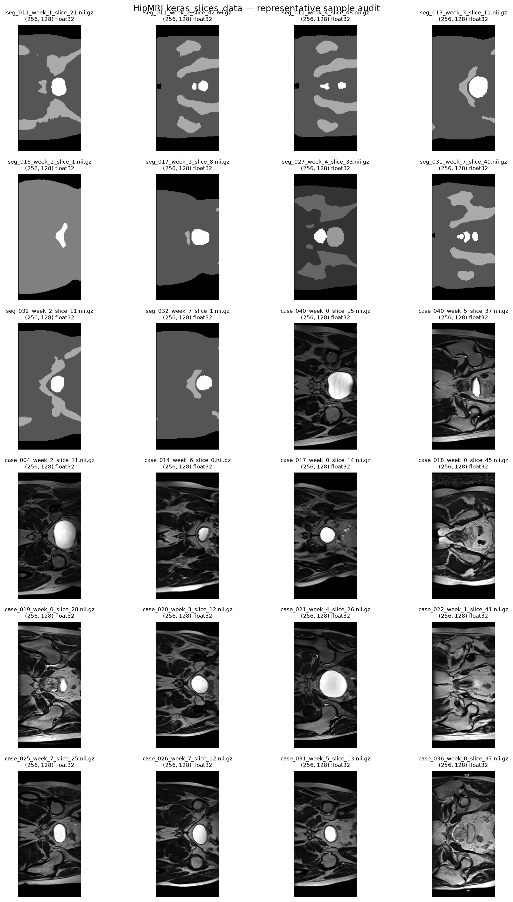

# Feasibility Check-Off

## 1. User Need, Scope & Acceptance Criteria

> The intended user, prototype purpose and 3–5 testable acceptance criteria
addressing the domain’s open dilemma, including an operational/resource
constraint (e.g., peak VRAM, runtime).

### User Need

Medical imaging research is constrained by stringent patient data privacy laws
(HIPAA, GDPR) and limited clinical scan availability. Generative models allow
synthesizing realistic synthetic cohorts for data augmentation and anonymized
multi-centre sharing. However, healthcare synthesis carries unique hazards:
the model must preserve authentic physiological tissue boundaries without mode
collapse, and must not hallucinate anatomically impossible structures or memorize
training scans (which would violate patient confidentiality).

The intended user is a medical imaging researcher or machine learning engineer
evaluating whether synthetic images can supplement real HipMRI data. The
prototype will implement a Vector-Quantised Variational Autoencoder (VQ-VAE) to
generate synthetic 2D HipMRI slices and investigate the trade-off between image
fidelity, sample diversity, and memorization of training data.

The key dilemma is determining whether scans that are anatomical valid without
becoming blurry or facing mode collapse, hallucinating physiologically
impossible tissue junctions or non-existent pathologies and without producing
verbatim memorization of training patient scans.

If a generative model simply memorizes training scans, sharing the synthetic
dataset constitutes an illegal breach of patient confidentiality. However, if it
hallucinates unrealistic tissue structures, downstream models trained on it will
learn hazardous diagnostic artifacts.

### Scope

The project is scoped to 2D HipMRI image generation using the provided
`keras_slices_data` dataset. It will compare VQ-VAE against a simpler
autoencoder baseline under consistent data splits and evaluation conditions.

### Acceptance criteria

- [ ] Train a VQ-VAE that can reconstruct input HipMRI slices and generate new
    samples through its learned discrete latent representation.
- [ ] Evaluate generated or reconstructed images using Structural Similarity
    Index (SSIM), targeting a value above 0.6
- [ ] Compare VQ-VAE against a basic autoencoder using the same data split and
    comparable evaluation procedures, reporting quantitative results and
    representative image grids.
- [ ] Audit generated samples against training images using nearest-neighbour
    comparisons and inspect latent-space interpolations to investigate
    memorization, mode collapse, and anatomical plausibility.
- [ ] Record training duration, peak GPU memory usage, model parameter count,
    and generation runtime. Establish a practical training budget on the Rangpur
    A100 cluster and retain a checkpoint from the best validation run.

## 2. Model Choice & Course Concepts

> The proposed dataset configuration, model architecture, chosen difficulty band,
and how course concepts and literature support the choices.

### Dataset Configuration

Data: **HipMRI 2D slices**

The project will use the provided HipMRI 2D slices from keras_slices_data,
available through the COMP3710 project environment. Images will be loaded,
checked for corrupted or inconsistent dimensions, and normalized to a consistent
intensity range suitable for the selected reconstruction loss.

The dataset will be divided into training, validation, and test sets before model
training. Where patient identifiers or source-volume information are available,
slices from the same patient or volume will be kept within a single split to
reduce data leakage. The training set will be used to learn model parameters,
the validation set to select configurations and checkpoints, and the test set
reserved for final evaluation.

### Model Architecture and Difficulty

Model: **Vector-Quantised Variational Autoencoder (VQ-VAE)**
Difficulty band: **Hard Difficulty**

VQ-VAE uses an encoder to map an image into a lower-dimensional latent
representation. The representation is quantized by assigning latent vectors to
entries in a learned discrete codebook. A decoder then reconstructs the image
from the quantized representation. The training objective combines
reconstruction loss with terms that train the codebook and encourage the encoder
to use its discrete representations effectively.

The discrete latent representation provides a way to learn recurring image
structures, but it can also introduce reconstruction artifacts or underuse of
the codebook. These behaviours will be investigated through reconstruction
comparisons, codebook usage statistics, and generated sample grids.

The implementation will use PyTorch and run on the Rangpur A100 GPU cluster. The
architecture will begin with a relatively small convolutional encoder and
decoder, with the latent dimensionality, codebook size, and reconstruction
objective selected to suit the resolution and characteristics of the dataset.

### Relevant Course Concepts and Literature

The project applies convolutional neural networks, representation learning,
encoder-decoder architectures, reconstruction losses, latent representations,
optimization, validation, and quantitative model evaluation.

The assessment specification identifies VQ-VAE as a Hard Difficulty model for
HipMRI 2D slices and cites "Neural discrete representation learning" by NeurIPS
(2017). A basic autoencoder will provide the required simpler generative
baseline. The comparison will examine whether discrete latent quantization
provides useful improvements in image structure and diversity relative to the
simpler model.

The central research question is whether VQ-VAE can generate anatomically
plausible and sufficiently diverse synthetic images without reproducing training
examples. The final recommendation will be based on experimental evidence rather
than visual quality alone.

## 3. Preliminary Feasibility Evidence

> An initial data audit, baseline smoke-test experiment, or measured resource
estimate. A fully trained final model is not required.

### Initial Data Audit

- [x] Confirm that `keras_slices_data` is accessible in the COMP3710 environment
    and determine the number of available images.
- [x] Inspect image dimensions, intensity ranges, data types, missing or
    corrupted images, and representative samples.
- [x] Check whether patient or source-volume identifiers are available to support
    leakage-resistant data splitting
- [x] Display a sample grid to assess anatomical content, image quality, and the
    preprocessing required by the model.

#### Preliminary Results

The initial audit was conducted on Rangpur using the provided `keras_slices_data`
directory. The directory was accessible, and `25,320` candidate `NIfTI` files were
inspected successfully, with no unreadable files or detected non-finite voxel
values. All files used `float32` data. The observed dimensions were `256 × 128`
for `25,200` files and `256 × 144` for `120` files. The global observed
intensity range was `[0, 1212]`.

The sample grid indicated that the directory may contain both MRI images and
segmentation masks. Therefore, the total file count cannot yet be interpreted as
the number of usable MRI training images. No separate metadata-like files were
identified, so patient or source-volume identifiers must be validated from the
filenames or dataset documentation before creating leakage-resistant splits.

The initial results support proceeding with data characterization and a small
training smoke test. Before full training, the MRI and segmentation files will
be separated, the differing image dimensions investigated, and a patient-level
train/validation/test split established. Intensity normalization and model input
dimensions will be selected based on the resulting MRI-only statistics.

### Baseline Smoke Test

A small basic autoencoder will first be trained for a few epochs to verify data
loading, GPU execution, loss computation, and image reconstruction. This will
establish a working pipeline before introducing vector quantization.

The VQ-VAE will then be tested on a small subset of the dataset using a compact
convolutional encoder-decoder, a modest codebook, and a limited number of
epochs. The smoke test will verify that:

- [ ] The training and validation losses remain finite.
- [ ] The model can reconstruct input images without tensor-shape or numerical errors.
- [ ] The codebook is being used rather than collapsing to only a few entries.
- [ ] GPU memory consumption and iteration time are manageable.
- [ ] Model checkpoints can be saved and loaded successfully.

### Preliminary Resource Estimate

The project will use the Rangpur A100 cluster rather than relying on the limited
memory of a local laptop. The initial resource budget is a provisional planning
estimate, not a measured benchmark.

Activity | Proposed budget
--- | ---
Data audit and preprocessing | 1–2 hours
Baseline and VQ-VAE smoke tests | 1–2 GPU hours
Initial hyperparameter experiments | 2–4 GPU hours
Final training and evaluation | 2–4 GPU hours
--- | ---
Initial total budget | 6–12 GPU hours

Actual training duration will depend on dataset size, image resolution, model
configuration, and GPU utilization. The budget will be revised after measuring
the smoke-test throughput. Full training will proceed only after the preliminary
results indicate that the target is achievable within the available resources.

## 4. Risks, Budget & Fallback

> Key technical risks, computing budget, the next planned experiment, and a
workable fallback.

### Key Technical Risks

Risk | Mitigation
--- | ---
Poor reconstruction quality | Inspect reconstruction grids, verify normalization and loss scaling, and tune model capacity and learning rate.
Codebook collapse or limited codebook usage | Monitor the number of active codebook entries and quantization behaviour; adjust codebook size and optimization settings if necessary.
Memorization of training images | Keep validation and test data separate, compare generated images with nearest training neighbours, and inspect unusually close matches.
Mode collapse or limited sample diversity | Generate uncurated sample grids across multiple random seeds and assess whether outputs show meaningful variation.
Data leakage between slices | Split by patient or source volume where identifiers are available, rather than randomly splitting individual slices from the same subject.
Excessive training time or GPU memory use | Begin with low-resolution inputs and a compact model, measure peak GPU memory, and increase model capacity only when justified by results.
Unreliable evaluation | Compare the VQ-VAE and baseline using consistent data splits and clearly distinguish reconstruction metrics from metrics on newly generated samples.

### Computing Budget and Experiment Plan

The initial allocation is 6–12 GPU hours on Rangpur, with additional time
requested only if the measured training rate or evaluation results justify it.
Experiments will be recorded with their configuration, random seed, training
duration, validation loss, SSIM, peak GPU memory, and checkpoint location.

The first experiment will be the data audit and baseline smoke test. If that
succeeds, a compact VQ-VAE will be trained and evaluated before conducting a
small hyperparameter search. The final configuration will be selected using
validation results, and the held-out test set will be used for final reporting.

### Fallback Strategy

If the initial VQ-VAE is unstable or exceeds the computing budget, the first
fallback will be to reduce input resolution, channel widths, latent
dimensionality, or the number of training epochs. The codebook and quantization
mechanism will be retained so that the implementation still addresses the
selected Hard Difficulty task.

If quantization remains unstable, the basic autoencoder will serve as a
functioning baseline for diagnosing the problem and comparing reconstruction
quality. The implementation will document the limitation and any unsuccessful
experiments rather than claiming that the VQ-VAE met the acceptance criteria
without evidence.

If synthetic image quality remains poor, the project will focus on diagnosing
the failure through reconstruction comparisons, codebook usage, sample
diversity, and nearest-neighbour analysis. The final engineering recommendation
will state whether the evidence supports using the generated images and identify
the limitations that remain.

The project is feasible in principle because it uses 2D images and a
convolutional encoder-decoder rather than a computationally heavier hierarchical
generator. However, feasibility will be confirmed only after the dataset audit
and measured smoke test. The key success criterion is not merely producing
images, but demonstrating their fidelity, diversity, and lack of obvious
training-data memorization through reproducible experiments.
