# Generating Synthetic Hip MRI Slices with a VQ-VAE and Autoregressive Prior [Hard Difficulty]

Student ID: `s4884249`

## Project Description

Medical imaging research is constrained by stringent patient data privacy laws (HIPAA, GDPR) and limited clinical scan availability. Generative models allow synthesizing realistic synthetic cohorts for data augmentation and anonymized multi-centre sharing. However, healthcare synthesis carries unique hazards: the model must preserve authentic physiological tissue boundaries without mode collapse, and must not hallucinate anatomically impossible structures or memorize training scans (which would violate patient confidentiality).

### User Need

The intended user is a medical imaging researcher or machine learning engineer evaluating whether synthetic images can supplement real HipMRI data. The prototype will implement a Vector-Quantised Variational Autoencoder (VQ-VAE) to generate synthetic 2D HipMRI slices and investigate the trade-off between image fidelity, sample diversity, and memorization of training data.

The key dilemma is determining whether scans that are anatomical valid without becoming blurry or facing mode collapse, hallucinating physiologically impossible tissue junctions or non-existent pathologies and without producing verbatim memorization of training patient scans.

If a generative model simply memorizes training scans, sharing the synthetic dataset constitutes an illegal breach of patient confidentiality. However, if it hallucinates unrealistic tissue structures, downstream models trained on it will learn hazardous diagnostic artifacts.

### Scope

The project is scoped to 2D HipMRI image generation using the provided `keras_slices_data` dataset. It will compare VQ-VAE against a simpler Autoencoder baseline under consistent data splits and evaluation conditions.

### Acceptance criteria

- [x] Train a VQ-VAE that can reconstruct input HipMRI slices.
- [x] Train a VQ-VAE that can generate new samples through its learned discrete latent representation.
- [x] Evaluate generated or reconstructed images using Structural Similarity Index (SSIM), targeting a value above `0.6`
- [x] Compare VQ-VAE against a basic autoencoder using the same data split and comparable evaluation procedures, reporting quantitative results and representative image grids.
- [x] Audit generated samples against training images using nearest-neighbour comparisons and inspect latent-space interpolations to investigate memorization, mode collapse, and anatomical plausibility.
- [x] Record training duration, peak GPU memory usage, model parameter count, and generation runtime. Establish a practical training budget and retain a checkpoint from the best validation run.

## Preliminary Feasibility Evidence

### Initial Data Audit

- [x] Confirm that `keras_slices_data` is accessible in the COMP3710 environment and determine the number of available images.
- [x] Inspect image dimensions, intensity ranges, data types, missing or corrupted images, and representative samples.
- [x] Check whether patient or source-volume identifiers are available to support leakage-resistant data splitting.
- [x] Display a sample grid to assess anatomical content, image quality, and the preprocessing required by the model.

#### Preliminary Results

The initial audit was conducted on Rangpur using the provided `keras_slices_data` directory. The directory was accessible, and `25,320` candidate `NIfTI` files were inspected successfully, with no unreadable files or detected non-finite voxel values. All files used `float32` data. The observed dimensions were `256 × 128` for `25,200` files and `256 × 144` for `120` files. The global observed intensity range was `[0, 1212]`.


_Figure 1: Sample Grid_

The sample grid indicated that the directory contains both MRI images and segmentation masks. Therefore, the total file count cannot yet be interpreted as the number of usable MRI training images. No separate metadata-like files were identified, so patient or source-volume identifiers must be validated from the filenames or dataset documentation before creating leakage-resistant splits.

The initial results support proceeding with data characterization and a small training smoke test. Before full training, the MRI and segmentation files will be separated, the differing image dimensions investigated, and a patient-level train/validation/test split established. Intensity normalization and model input dimensions will be selected based on the resulting MRI-only statistics.

### Baseline Smoke Test

A small basic autoencoder will first be trained for a few epochs to verify data loading, GPU execution, loss computation, and image reconstruction. This will establish a working pipeline before introducing vector quantization.

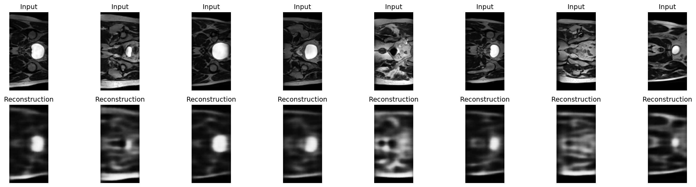
_Figure 2: Smoke test reconstruction grid_

he reconstruction grid demonstrates the baseline autoencoder's ability to encode and reconstruct MRI slices. The original images are shown above their corresponding reconstructions. The model successfully preserves some of the larger anatomical features, including the prominent high-intensity regions. 

However, the reconstructed images exhibit considerable blurring and loss of fine tissue detail. This is expected to some extent when using a compact latent representation and a pixel-based reconstruction objective such as mean squared error (MSE), which tends to favour averaged predictions when multiple plausible outputs exist.

This experiment is nevertheless important because it establishes that the data-loading pipeline, model architecture, loss calculation and training process operate correctly. It also provides an initial indication of the reconstruction quality achievable with a relatively simple architecture.

Importantly, successful reconstruction does not demonstrate that a model can generate realistic new images. An autoencoder can reconstruct images by encoding information from an existing input without learning a latent distribution from which independent samples can be reliably generated. Consequently, reconstruction quality and generative quality must be evaluated separately.

- [x] The training and validation losses remain finite.
- [x] The model can reconstruct input images without tensor-shape or numerical errors.
- [x] GPU memory consumption and iteration time are manageable.
- [x] Model checkpoints can be saved and loaded successfully.

### Preliminary Resource Estimate

The project will use a MacBook Pro (M5 Pro, 64GB) rather than relying on the limited memory of a local computer. The initial resource budget is a provisional planning estimate, not a measured benchmark.

Activity | Proposed budget
--- | ---
Data audit and preprocessing | 1–2 hours
Baseline and VQ-VAE smoke tests | 1–2 GPU hours
Initial hyperparameter experiments | 2–4 GPU hours
Final training and evaluation | 2–4 GPU hours
--- | ---
Initial total budget | 6–12 GPU hours

## Risks, Budget & Fallback

### Key Technical Risks

| Risk | Mitigation
| --- | ---
| Poor reconstruction quality | Inspect reconstruction grids, verify normalization and loss scaling, and tune model capacity and learning rate.
| Codebook collapse or limited codebook usage | Monitor the number of active codebook entries and | quantization behaviour; adjust codebook size and optimization settings if necessary.
| Memorization of training images | Keep validation and test data separate, compare generated images with nearest training neighbours, and inspect unusually close matches.
| Mode collapse or limited sample diversity | Generate uncurated sample grids across multiple random seeds and assess whether outputs show meaningful variation.
| Data leakage between slices | Split by patient or source volume where identifiers are available, rather than randomly splitting individual slices from the same subject.
| Excessive training time or GPU memory use | Begin with low-resolution inputs and a compact model, measure peak GPU memory, and increase model capacity only when justified by results.
| Unreliable evaluation | Compare the VQ-VAE and baseline using consistent data splits and clearly distinguish reconstruction metrics from metrics on newly generated samples.

### Computing Budget and Experiment Plan

The initial allocation is 6–12 GPU hours on Rangpur, with additional time requested only if the measured training rate or evaluation results justify it. Experiments will be recorded with their configuration, random seed, training duration, validation loss, SSIM, peak GPU memory, and checkpoint location.

The first experiment will be the data audit and baseline smoke test. If that succeeds, a compact VQ-VAE will be trained and evaluated before conducting a small hyperparameter search. The final configuration will be selected using validation results, and the held-out test set will be used for final reporting.

### Fallback Strategy

If the initial VQ-VAE is unstable or exceeds the computing budget, the first fallback will be to reduce input resolution, channel widths, latent dimensionality, or the number of training epochs. The codebook and quantization mechanism will be retained so that the implementation still addresses the selected Hard Difficulty task.

If quantization remains unstable, the basic autoencoder will serve as a functioning baseline for diagnosing the problem and comparing reconstruction quality. The implementation will document the limitation and any unsuccessful experiments rather than claiming that the VQ-VAE met the acceptance criteria without evidence.

If synthetic image quality remains poor, the project will focus on diagnosing the failure through reconstruction comparisons, codebook usage, sample diversity, and nearest-neighbour analysis. The final engineering recommendation
will state whether the evidence supports using the generated images and identify the limitations that remain.

The project is feasible in principle because it uses 2D images and a convolutional encoder-decoder rather than a computationally heavier hierarchical generator. However, feasibility will be confirmed only after the dataset audit and measured smoke test. The key success criterion is not merely producing images, but demonstrating their fidelity, diversity, and lack of obvious training-data memorization through reproducible experiments.

Actual training duration will depend on dataset size, image resolution, model configuration, and GPU utilization. The budget will be revised after measuring the smoke-test throughput. Full training will proceed only after the preliminary results indicate that the target is achievable within the available resources.

## Dataset

The project will use the provided HipMRI 2D slices from keras_slices_data, available through the COMP3710 project environment. Images will be loaded, checked for corrupted or inconsistent dimensions, and normalised to a consistent intensity range suitable for the selected reconstruction loss.


_Figure 3: Sample slices for each train/validate/test directories_

The figure presents representative MRI slices from the training, validation and testing datasets. All three sets contain recognisable HipMRI anatomy, including variations in tissue boundaries, internal structures and the position and appearance of high-intensity regions.

The purpose of this comparison is to identify obvious distribution differences between the datasets before training. A model trained on a dataset that does not represent the variation present in the validation and testing datasets may achieve good training results but perform poorly on previously unseen patients.

The dataset is divided at the patient level rather than randomly assigning individual slices. This is particularly important for medical imaging because multiple slices from the same patient are likely to contain highly correlated anatomical information. Randomly distributing these slices across different splits would allow a model to encounter nearly identical patient-specific anatomy during training and testing, artificially increasing its reported performance.

The dataset audit confirms that there are no patients shared between the training, validation and testing sets. The figures provide a visual check of their contents, although a larger statistical comparison would be required to establish that the distributions are fully equivalent.

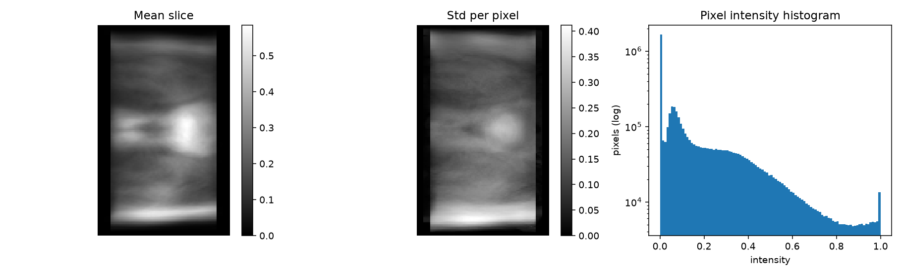
_Figure 4: Pixel statistics across all samples_

The figure provides three complementary views of the preprocessed dataset: the mean image, the per-pixel standard deviation and the overall pixel-intensity histogram.

The mean image represents the average intensity at each spatial location across the sampled images. Although individual anatomical structures become blurred when averaged, the resulting image still reveals the general spatial distribution of anatomical features. This demonstrates that the dataset contains recurring structural patterns that a generative model can potentially learn.

The standard-deviation image illustrates where the dataset exhibits the greatest variation. Regions with higher standard deviation correspond to locations where anatomical structures, tissue boundaries or intensities differ considerably between samples. This is useful for identifying which parts of the image contain consistent information and which contain substantial patient-specific variation.

The intensity histogram illustrates the distribution of normalised pixel values. Most pixels have relatively low intensities, with progressively fewer pixels occupying the brighter intensity range. This reflects the substantial background and darker tissue regions present in the images.

```console
== Files ==
manifest rows: 25320 | readable: 25320 | unreadable: 0
images: 12660 | masks: 12660

== Images and masks per split ==
train images  11460 | masks  11460
val   images    660 | masks    660
test  images    540 | masks    540

== Cases (patients) ==
train   31 cases | slices per case: min 60 | median 480 | mean 369.7 | max 480 | std 171.8
val      4 cases | slices per case: min 60 | median 60 | mean 165 | max 480 | std 181.9
test     3 cases | slices per case: min 60 | median 60 | mean 180 | max 420 | std 169.7
cases shared between splits: none (no leakage)

== Time points (weeks) ==
slices per week: {0: 2280, 1: 1620, 2: 1560, 3: 1560, 4: 1500, 5: 1440, 6: 1320, 7: 1380}
weeks per case: min 1 | median 8 | mean 5.553 | max 8 | std 3.151

== Image / mask pairing ==
images with a mask: 12660 / 12660 | masks without an image: 0

== Raw geometry ==
shape 256x128: 12600 (99.5%)
shape 256x144: 60 (0.5%)

== Raw intensities (per slice, before normalisation) ==
global min 0 | global max 1212
slice max         : min 196 | median 396 | mean 414.1 | max 1212 | std 110.7
slice mean        : min 26.87 | median 69.17 | mean 72.59 | max 268.2 | std 24.71
slice std         : min 35.68 | median 68.97 | mean 73.37 | max 226.6 | std 22.51
slice nonzero_frac: min 0.6934 | median 0.9087 | mean 0.8974 | max 0.957 | std 0.04143
(normalisation clips each slice to its 1st-99.5th percentile and rescales to [0, 1], so the raw scale varies freely between slices)

== Preprocessed pixels (500 random training slices, 128x80) ==
pixel mean 0.1719 | pixel std 0.2138
background (pixels < 0.05): 39.7%
per-slice mean: min 0.1012 | median 0.1622 | mean 0.1719 | max 0.2863 | std 0.04155
```
_Figure 5: Exploration of dataset structure, geometry and pixel intensity_

Overall there are `12660` usable images broken into an approximate 90/5/5 percent train/validate/test split that will be utilised throughout the project. Where patient identifiers or source-volume information are available, slices from the same patient or volume will be kept within a single split to reduce data leakage. The training set will be used to learn model parameters, the validation set to select configurations and checkpoints, and the test set reserved for final evaluation.

Across the 500 sampled training slices, the mean pixel intensity is 0.1719, with a standard deviation of 0.2138. Approximately 39.7% of pixels have an intensity below 0.05. This is important when interpreting reconstruction metrics because large background regions can contribute substantially to pixel-based loss functions. A model could achieve a relatively low reconstruction error without accurately reproducing every anatomically significant structure.

Consequently, the evaluation uses SSIM alongside MSE. SSIM places greater emphasis on structural similarity, making it a useful complementary measure when assessing whether tissue boundaries and local image structures have been preserved.

### Data Loading & Preprocessing

```python
# See `dataset.py`
def normalize_mri(array: np.ndarray) -> np.ndarray:
    """Per-slice scaling to [0, 1] after clipping to the 1st-99.5th percentile.

    Clipping stops a few very bright voxels from compressing the useful range, and
    per-slice scaling removes the arbitrary absolute intensity scale between scans.
    """
    low, high = np.percentile(array, [1.0, 99.5])
    if high <= low:  # constant slice: nothing to scale
        return np.zeros_like(array, dtype=np.float32)
    return ((np.clip(array, low, high) - low) / (high - low)).astype(np.float32)
```
_Figure 6: Slice normalisation code_

The preprocessing pipeline normalises each MRI slice independently by clipping pixel intensities to the 1st and 99.5th percentiles before rescaling the remaining values to the range `[0, 1]`.

Percentile clipping reduces the influence of unusually bright pixels, preventing a small number of extreme intensities from compressing the useful intensity range of the remaining image. Per-slice normalisation also reduces differences in absolute intensity between scans, allowing the model to concentrate on learning anatomical structures and relative tissue contrast.

This approach is particularly useful for reconstruction-based generative models because consistent input scaling improves numerical stability and makes the reconstruction objective more consistent across samples. However, per-slice normalisation also removes some absolute intensity information. Therefore, the generated images should not be interpreted as preserving quantitative MRI signal characteristics.

```python
# See `dataset.py`
def load_manifest(
    manifest_path: Path, data_root: Path, keep_shape: str = SOURCE_SHAPE_TEXT, min_nonzero_frac: float = 0.0
) -> List[Dict[str, str]]:
    """Return the readable image rows (path, split, group_id).

    Dropped: masks, rows with a read error, images whose shape is not `keep_shape`
    (default 256x128), blank slices (constant intensity, so there is nothing to learn from;
    they would all normalise to an all-zero image) and, if `min_nonzero_frac` > 0, slices
    with a smaller fraction of non-zero voxels.
    """
    data_root = data_root.expanduser().resolve()
    rows = []
    dropped_shapes: Counter = Counter()
    n_blank = n_sparse = 0
    for source in read_manifest(manifest_path):
        if source["kind"] != "image" or source["error"]:
            continue
        if keep_shape and source["shape"] != keep_shape:
            dropped_shapes[source["shape"] or "unknown"] += 1
            continue
        if _number(source["std"], 1.0) <= 1e-8:
            n_blank += 1
            continue
        if _number(source["nonzero_frac"], 1.0) < min_nonzero_frac:
            n_sparse += 1
            continue
        if not (data_root / source["path"]).is_file():
            raise FileNotFoundError(f"Manifest file missing under --data-root: {data_root / source['path']}")
        rows.append({k: source[k] for k in ("path", "split", "group_id")})
    if dropped_shapes:
        print(f"Dropped images whose shape is not {keep_shape}: {dict(dropped_shapes)}")
    if n_blank or n_sparse:
        print(f"Dropped {n_blank} blank slices and {n_sparse} slices below nonzero_frac {min_nonzero_frac}")
    print(f"Kept {len(rows)} images")
    if not rows:
        raise ValueError(f"The manifest contains no usable {keep_shape} image rows")
    return rows
```

```console
Dropped images whose shape is not 256x128: {'256x144': 60}; kept 12600
```
_Figure 7: Manifest loading and dropping of miss-shaped samples_

The preprocessing pipeline also removes blank slices and images with inconsistent dimensions. The 60 images with dimensions of 256 × 144 were excluded, leaving 12,600 images with a consistent original resolution of 256 × 128. This avoids introducing geometric distortions or inconsistent input dimensions when batching the images for training.

## Installation Instructions

```shell
# Install Python 3.14 (use appropriate package manager)
brew install python@3.14

# Create virtual enviroment
/opt/homebrew/bin/python3.14 -m venv .venv

# Activate virtual enviroment
source .venv/bin/activate

# Install required packages
python -m pip install -r requirements.txt
```
_Figure 8: Installation instructions (MacOS)_

## Model Architecture and Difficulty

Model: `Vector-Quantised Variational Autoencoder (VQ-VAE) + Transformer Prior`
Difficulty band: `Hard Difficulty`

VQ-VAE uses an encoder to map an image into a lower-dimensional latent representation. The representation is quantized by assigning latent vectors to entries in a learned discrete codebook. A decoder then reconstructs the image from the quantized representation. The training objective combines reconstruction loss with terms that train the codebook and encourage the encoder to use its discrete representations effectively.

The discrete latent representation provides a way to learn recurring image structures, but it can also introduce reconstruction artifacts or underuse of the codebook. These behaviours will be investigated through reconstruction comparisons, codebook usage statistics, and generated sample grids.

The implementation will use PyTorch and run on a MacBook Pro (M5 Pro, 64GB). The architecture will begin with a relatively small convolutional encoder and decoder, with the latent dimensionality, codebook size, and reconstruction objective selected to suit the resolution and characteristics of the dataset.

### VQ-VAE Advantages

The primary advantage of a Vector-Quantised Variational Autoencoder is its ability to represent images using a learned discrete latent representation rather than relying exclusively on a continuous latent distribution.

During encoding, the input image is compressed into a lower-dimensional representation. Each resulting latent vector is then replaced by the nearest entry in a learned codebook. The decoder reconstructs the image using these quantised representations.

This provides several advantages for medical image generation. Firstly, the discrete codebook encourages the model to learn a collection of recurring visual patterns. Instead of representing every image using entirely independent continuous values, the model learns reusable representations of local anatomical structures. This can make recurring tissue patterns easier to represent consistently.

Secondly, the discrete representation provides a suitable foundation for learning spatial relationships between latent codes. An additional autoregressive model can learn the probability of each code given the codes that precede it. This allows the model to generate new latent representations by learning how different local structures should be arranged together.

This is particularly important for HipMRI because generating anatomically plausible tissue regions requires more than reproducing locally realistic textures. Structures such as the bladder, body outline and surrounding tissues must also maintain reasonable spatial relationships.

Finally, codebook usage provides additional diagnostic information. Active-code counts and perplexity can be monitored to determine whether the model uses its available representations effectively or has collapsed onto a small subset of the codebook.

The final experiments demonstrate the practical benefits of this approach, with the VQ-VAE achieving stronger reconstruction SSIM and substantially improving the feature-distribution metrics relative to the VAE baseline.

### VQ-VAE Disadvantages

The quantisation process restricts the encoder to selecting from a finite set of codebook entries. Although this encourages consistent representations, it also introduces information loss because the original continuous latent representation must be approximated using the available codes. If the codebook is too small or insufficiently expressive, important anatomical details may not be represented accurately.

Another potential problem is codebook collapse. This occurs when the encoder repeatedly selects only a small proportion of the available codebook entries, leaving the remaining entries effectively unused. This reduces the representational capacity of the model and may limit the diversity of generated images. Monitoring active codes and perplexity is therefore necessary to identify this behaviour.

More importantly, generating images requires learning a prior over the spatial arrangement of discrete codes. A codebook can contain representations of realistic local tissue patterns without necessarily learning how those patterns should be arranged across an entire image. An inadequate prior may consequently generate locally plausible structures while producing anatomically inconsistent complete images.

The additional transformer required to model these relationships increases the number of parameters, training time and generation latency. Unlike the VAE, which can generate an image by sampling a continuous latent vector and decoding it in a single forward pass, an autoregressive prior predicts discrete tokens sequentially.

Finally, discrete representations do not inherently guarantee privacy or anatomical correctness. A VQ-VAE can still reproduce training examples or generate unrealistic anatomical structures. Nearest-neighbour comparisons, sample diversity measurements and anatomical inspection are therefore essential when evaluating whether the resulting synthetic images are suitable for further research.

### Relevant Course Concepts and Literature

The project applies convolutional neural networks, representation learning, encoder-decoder architectures, reconstruction losses, latent representations, optimization, validation, and quantitative model evaluation.

The assessment specification identifies VQ-VAE as a Hard Difficulty model for HipMRI 2D slices and cites "Neural discrete representation learning" by NeurIPS (2017). A basic autoencoder will provide the required simpler generative baseline. The comparison will examine whether discrete latent quantization provides useful improvements in image structure and diversity relative to the simpler model.

The central research question is whether VQ-VAE can generate anatomically plausible and sufficiently diverse synthetic images without reproducing training examples. The final recommendation will be based on experimental evidence rather than visual quality alone.
## 
## File Structure

```console
recognition/VQ-VAE_s4884249/
├── architecture_figure.py
├── codebook_utilisation.py
├── dataset.py
├── device_utils.py
├── eval_analysis.py
├── eval_metrics.py
├── eval_plots.py
├── evaluate.py
├── experiments.py
├── explore.py
├── images
│   └── ...
├── manifest.csv
├── modules.py
├── params.py
├── predict.py
├── README.md
├── requirements.txt
├── train.py
└── utils.py
```
_Figure 9: File tree_

| File | Purpose |
|---|---|
| `modules.py` | Convolutional VAE baseline; residual VQ-VAE (residual encoder/decoder, EMA vector quantizer with dead-code restarts); causal-transformer autoregressive code prior |
| `dataset.py` | NIfTI audit that writes `manifest.csv`, MRI/mask classification, intensity preprocessing and resizing, and case-level train/val/test splitting with a leakage check |
| `train.py` | Training and validation, checkpoint selection, test metrics, codebook statistics, gradient-norm logging, code-prior training and resource tracking |
| `predict.py` | Sample generation, reconstruction grids, latent interpolation, nearest-neighbour audits and failure-case visualisations for a single run |
| `params.py` | Central training and prediction settings, command-line overrides and run-directory naming |
| `utils.py` | Shared helpers: seeding, SSIM (NumPy and differentiable), JSON/CSV I/O and image-grid saving |
| `device_utils.py` | Device selection (CUDA, Apple MPS, CPU), synchronisation and peak-memory helpers |
| `manifest.csv` | Generated file inventory (split, kind, case ID, shape and intensity statistics per NIfTI file) |
| `explore.py` | Dataset exploration from the manifest (distributions, shapes, splits, sample slices) |
| `experiments.py` | Runs the configuration experiments and ablations |
| `evaluate.py` | Evaluation entry point: loads the VAE and VQ-VAE runs, generates uncurated sample cohorts, profiles runtime and memory, then runs the analysis |
| `eval_analysis.py` | Computes metrics, applies the pass/fail verdict criteria |
| `eval_metrics.py` | Torch-free metrics: Fréchet distance, precision/recall/density/coverage, best-match SSIM, nearest-neighbour and data-copying tests, mode occupancy, artefact detectors |
| `eval_plots.py` | Figure helpers for training curves, sample grids, t-SNE, memorisation audit, failure autopsy and interpolation |
| `architecture_figure.py ` | Produces the model architecture diagram based on the given training parameters for the README section |
| `codebook_utilisation.py` | Produces a numerical and graphical analysis of the codebook utilisation on validate that the entire codebook is being used |
| `images/` | Figures and screenshots referenced by the README |
| `README.md` | Comprehensive report and experiment documentation |
| `requirements.txt` | Required Python libraries |

## Baseline Architecture: VAE

The original baseline was a deterministic autoencoder. However, a deterministic autoencoder does not explicitly learn a probability distribution over its latent representations. Consequently, generating images by randomly sampling its latent space can produce representations that do not correspond to the distribution encountered during training.

A VAE learns a probabilistic latent representation by predicting the parameters of a distribution for each input image. During training, latent vectors are sampled from this distribution and used to reconstruct the input. A Kullback–Leibler (KL) divergence term encourages the learned distributions to remain close to a standard normal distribution.

This regularisation provides a more meaningful latent space from which previously unseen samples can be generated. Random vectors sampled from the standard normal distribution can be decoded without requiring an existing training image as a starting point.

The VAE therefore provides a more appropriate generative baseline for comparison against the VQ-VAE. As such, the baseline was upgraded to a Variational Autoencoder (VAE) after the issue was identified in version 1. This change was propagated through all future versions including the final baseline benchmark and comparison.

## Changelog

Some changes were made to the Preliminary models when issues were identified which would prevent the task to be completed successfully with the project's scope.

### Version 1

The first implementation generated new samples by encoding existing training images, identifying nearby latent representations, interpolating between them and decoding the resulting representations.

The resulting images demonstrate that the autoencoder has learned a latent representation containing meaningful anatomical information. Rather than producing completely random outputs, the interpolation process produces images containing recognisable tissue structures and varying anatomical features.

This approach is useful for initially investigating the organisation of the latent space. If nearby latent representations produce similar decoded images, it suggests that the encoder has learned a degree of continuity between related image structures.

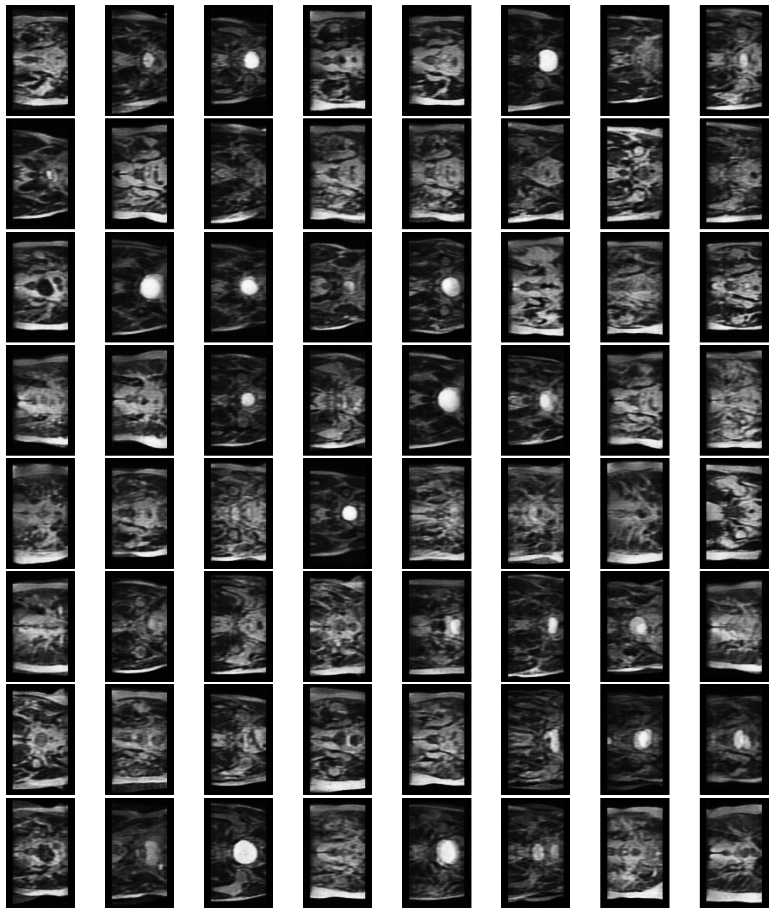
_Figure 10: AE - Generated samples from nearby latent representations_

However, these outputs are interpolations between representations derived from existing training images. They are not independent samples from a learned probability distribution. Consequently, the results may retain substantial similarities to the original training images and do not demonstrate that the model can reliably generate genuinely new samples. To properly compare the model with the VQ-VAE, the baseline model was upgraded to a VAE such that the latent space was regularised so sampling can produce more meaningful and unseen samples.

> **Takeaway**
To achieve a reasonable baseline, a VAE was used rather than a basic AE such that new samples can be more reliably generated from the latent distribution as required to fulfill ethical and task constraints (i.e. generating truly new samples rather than recreating existing images).

### Version 2

The introduction of the VAE initially resulted in a considerable reduction in the visual quality of the generated images. Despite training for 50 epochs, the generated samples predominantly resemble random textures rather than coherent MRI slices.

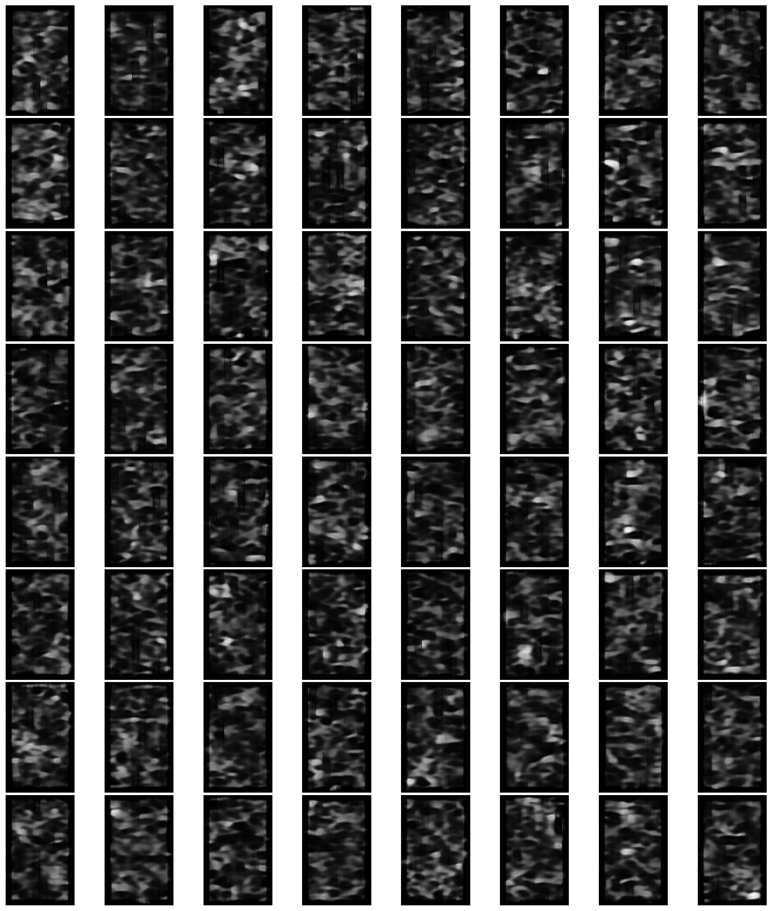
_Figure 11: VAE - Generated samples from the learned prior after 50 epochs_

This demonstrates an important distinction between learning to reconstruct training images and learning a latent distribution that can generate realistic new images. The reconstruction objective encourages the encoder and decoder to preserve information about the input, whereas random generation requires the decoder to produce meaningful outputs from samples drawn from the prior distribution.

The results indicate that simply introducing a probabilistic latent representation does not guarantee successful image generation. The model must also learn a sufficiently structured latent space so that samples drawn from the prior correspond to anatomically meaningful representations.

> **Takeaway**
This experiment therefore motivated further investigation into latent dimensionality, KL regularisation and the relationship between the training distribution and the sampling distribution.

### Version 3

To optimise the results and identify causes for model collapse, detailed hyper-parameter adjustments must be made. To achive this, the code was modified to provide up to 10 sample reconstructions over the course of the training process such that the point at which the training should stop could be determined as not to either over-fit/under-fit the training data. These reconstruction grids demonstrate how both models develop their ability to reproduce the input images throughout training.

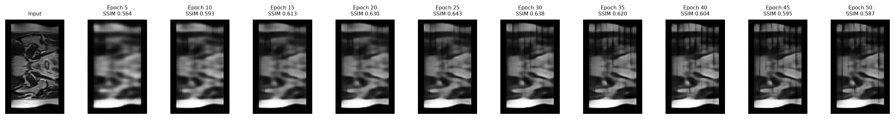
_Figure 12: VAE - Reconstruction by Epoch_

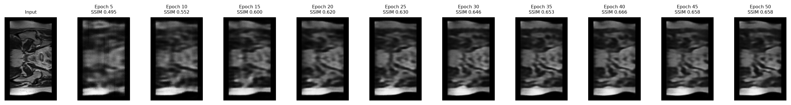
_Figure 13: VQ-VAE - Reconstruction by Epoch_

In the earlier epochs, the reconstructions contain limited structural detail and appear comparatively blurred. As training progresses, larger anatomical features become increasingly recognisable, and the decoder becomes better at reproducing the general intensity patterns and spatial arrangement of the input images.

Monitoring reconstruction quality across epochs is useful because a single final reconstruction grid does not reveal how the model reached its final performance. It allows the point at which useful improvements begin to diminish to be identified and helps distinguish underfitting from potential overfitting.

The results also highlight why reconstruction images should be evaluated alongside generated samples. A model may continue improving its reconstruction ability without improving its capacity to generate realistic images from randomly sampled latent representations.

The experiment additionally identified a practical limitation with the available hardware: the original implementation did not support Apple's Metal Performance Shaders (MPS) backend. This made repeated experiments unnecessarily time-consuming and prevented efficient hyperparameter comparisons.

> **Takeaway**
Regardless of the effeciancey of the model, the performance depends on the availability of appropriate hardware. The model could use the latest inovation in mathematics and computer science but without appropriate hardware it will be slow and possibly unusable if the use case is time sensitive.

### Version 4

Apple Silicon GPU (MPS) support was added such that the models could be efficently run on the MacBook Pro being used for training. 

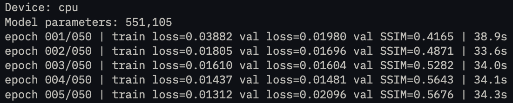
_Figure 14: CPU Version_

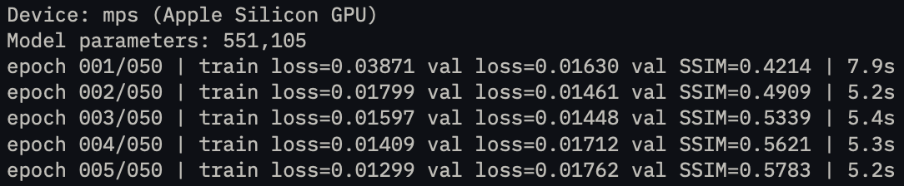
_Figure 15: GPU Version_

Both configurations use the same model architecture containing 551,105 parameters. Their training losses and validation SSIM values are also comparable across the five measured epochs.

However, the CPU implementation requires approximately 34–39 seconds per epoch, compared with approximately 5–8 seconds using MPS. This represents a substantial reduction in training time.

GPU acceleration is important because the project requires repeated training experiments to evaluate architectural changes and hyperparameter configurations. Reducing the time required for each experiment allows more configurations to be tested within the available computing budget.

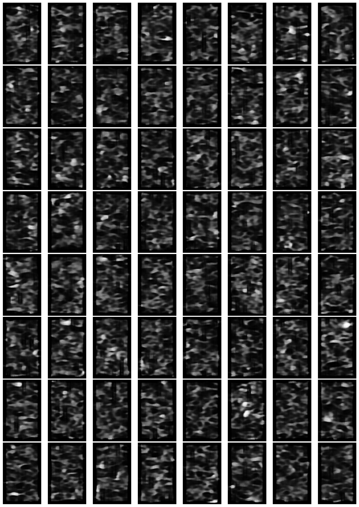
_Figure 16: VAE - Generated Samples_

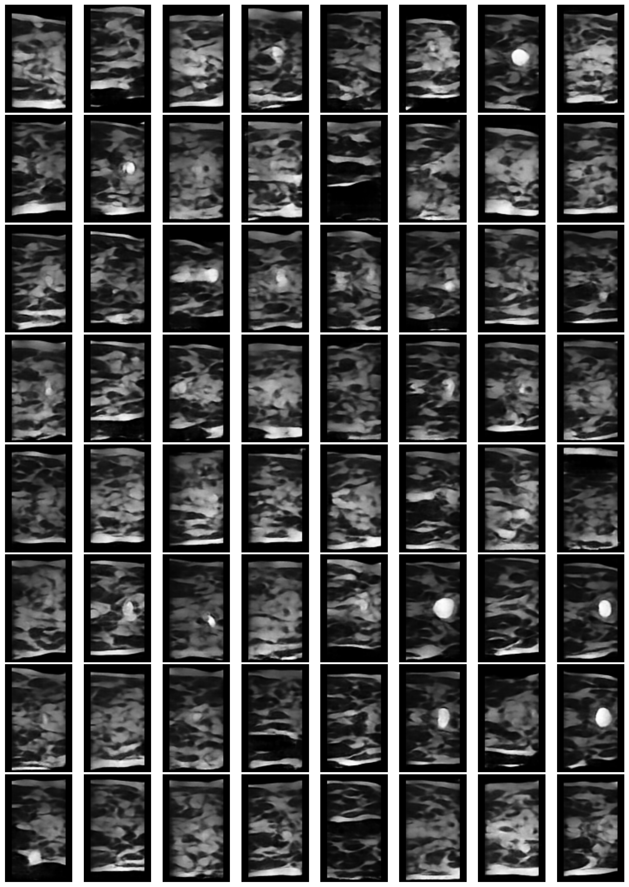
_Figure 17: VQ-VAE - Generated Samples_

Figures 16 & 17 also illustrate that hardware acceleration does not automatically improve model accuracy. Both implementations still produce poor learning results because the model and training procedure remain unchanged. The primary benefit is increased computational throughput rather than an improvement in the underlying learning algorithm.

> **Takeaway**
Increasing or decreasing computing power did not affect the quality or accuracy of the generated sample, only allowed for more efficent experemenation by reducing the models' training times.

### Version 5

In addition to now dropping the `256x144` images and maintaining the original aspect ration, the VAE issue with the generation of new samples was solved. The main problem was that the old VAE had too much spatially independent latent information and no mechanism to learn the spatial correlations needed for realistic anatomy. It reconstructed images well but was not necessarily able to generate realistic new ones.

The VAE was changed from a high-dimensional spatial latent representation to a compact, globally regularised latent vector, with revised KL scaling to improve the potential quality of random samples.

The latent representation eas changed from a spatial latent map of `64 × 16 × 10 = 10,240` values to a single global latent vector of `256` values per image. This creates a stronger bottleneck and encourages the model to represent the overall image structure. The KL loss was adjusted to encourage latent vectors to follow a standard normal distribution, N(0,I), making random sampling more consistent with the decoder's training di stribution. Finally, the KL term was changed to be summed over latent dimensions and divided by the number of image pixels. The default kl_beta is now `0.01`, providing a tunable balance between reconstruction quality and latent regularisation.

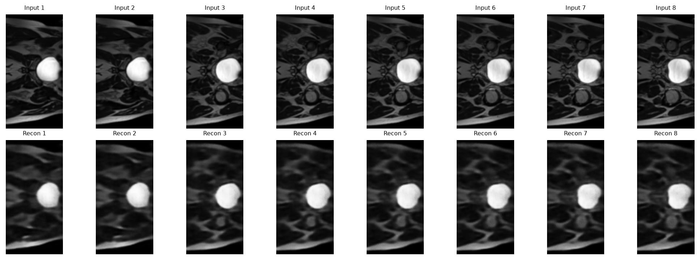
_Figure 18: VAE - Reconstruction Grid_

The reconstruction examples show that the revised VAE successfully preserves the main spatial arrangement of the input MRI slices. In particular, the prominent central high-intensity regions remain recognisable, and the surrounding tissue patterns are broadly maintained. However, finer boundaries and smaller structures are noticeably smoother than in the original images.

This demonstrates the effect of the stronger latent bottleneck. The model retains information that is useful for reconstructing the overall image while discarding some lower-level detail. The reconstruction grid is important because it verifies that the revised latent representation has not prevented the VAE from reconstructing meaningful anatomical structures, even though the latent space has been substantially compressed

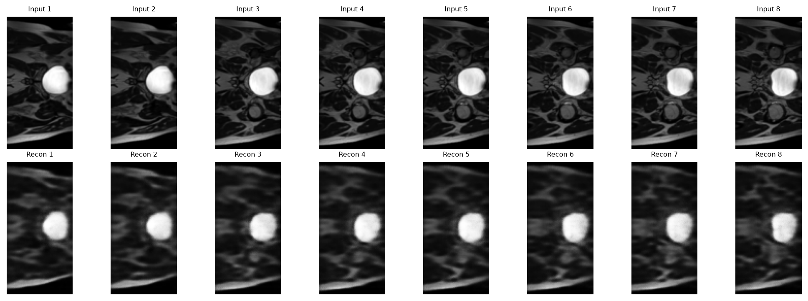
_Figure 19: VQ-VAE - Reconstruction Grid_

The corresponding VQ-VAE reconstruction grid demonstrates its ability to reconstruct the same general anatomical structures using discrete latent representations. The reconstructed images retain the prominent high-intensity regions and broader surrounding tissue structures. This demonstrates that quantisation has not prevented the model from retaining the most visually significant information from the input.

Comparing this grid with the VAE reconstruction grid provides a qualitative assessment of the differences introduced by discrete quantisation. The VQ-VAE must preserve information using a limited codebook, whereas the VAE uses a continuous latent representation. This comparison is important because it helps establish whether the additional representational constraints introduced by vector quantisation result in unacceptable information loss or improve the consistency of learned image structures.

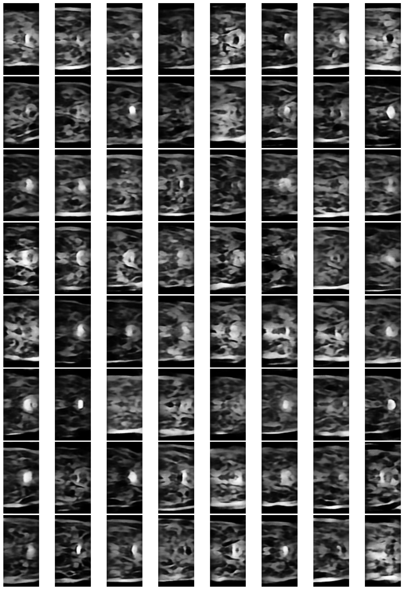
_Figure 20: VAE - Generated Samples_

The revised VAE produces substantially more coherent generated samples than the earlier implementation. The images now contain more recognisable anatomical structures, including distinguishable tissue boundaries and prominent high-intensity regions. Although the results remain somewhat blurred, the generated samples demonstrate that the changes to the latent representation have improved the decoder's ability to produce meaningful outputs from randomly sampled latent vectors.

The improvement supports the decision to use a compact global latent representation. By encouraging the model to capture overall image structure, the decoder receives a more organised representation from which to reconstruct an image. However, these results do not demonstrate that every generated structure is anatomically valid. Quantitative evaluation and inspection of the generated samples are still required.

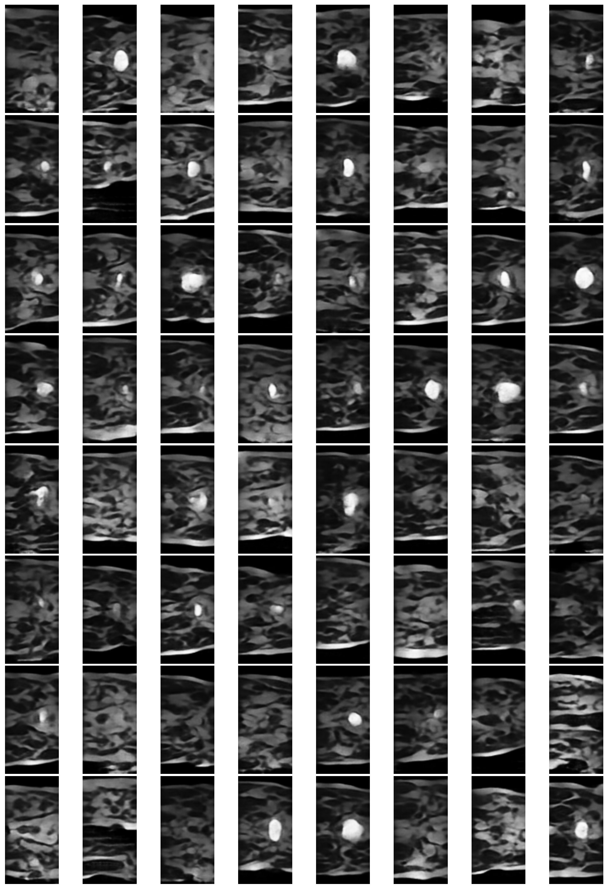
_Figure 21: VQ-VAE - Generated Samples_

The VQ-VAE generated samples exhibit recognisable anatomical patterns and variations between images. The outputs demonstrate that the model can produce more than simple repetitions of individual image textures. However, the overall arrangement of anatomical structures is not consistently preserved across the generated cohort.

A particularly important consideration is that learning a discrete representation is not equivalent to learning the probability distribution of valid arrangements of those representations. The model must also learn how individual latent codes relate spatially to one another.

Nevertheless, the generated images remain relatively soft and do not consistently demonstrate that all anatomical structures are arranged correctly. Visual improvements alone therefore cannot establish that the model has learned a sufficiently accurate representation of the underlying medical images. The results motivated further improvements to the VAE latent representation and additional work on the VQ-VAE's sampling process

> Takeaway
Overall, the generated anatomy was more coherent because the decoder receives a compact global representation rather than an independently sampled spatial latent map. The trade-off being that the MSE reconstruction loss may still produce blurry images. Additionally, with the `256x144` samples removes, there are no longer black bars on the edges.

### Version 6

Monitoring generated samples throughout training provides additional information that cannot be obtained from reconstruction loss alone. The generated-sample grids allow the development of image quality and anatomical structure to be observed across successive training epochs. This is particularly important for generative models because reconstruction quality can continue improving even when the learned sampling distribution remains poor.

Comparing generated outputs across epochs helps identify whether additional training improves anatomical coherence, introduces artefacts or produces diminishing returns. The inclusion of both reconstruction and generation monitoring therefore provides a more complete basis for selecting model checkpoints.

This version also introduces early stopping based on validation cross-entropy. This is useful for preventing unnecessary training when the model's ability to predict unseen latent codes no longer improves. Unlike training loss, validation cross-entropy provides an indication of whether the learned code distribution generalises beyond the training examples.

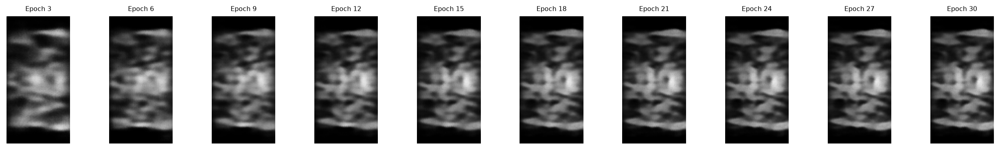
_Figure 22: VAE - Generated Samples Per Epoch_

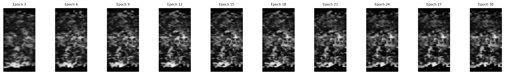
_Figure 23: VQ-VAE - Generated Samples Per Epoch_

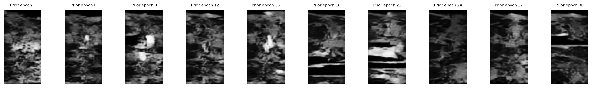
_aFigure 24: VQ-VAE - Generated Samples Per Prior Epoch_

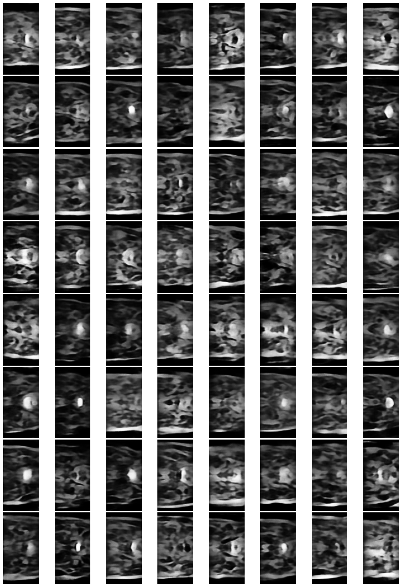
_Figure 25: VQ-VAE - Generated Samples after 300 Prior Epochs_

Figure 25 demonstrates that extending prior training does not necessarily resolve problems with global anatomical consistency. Although individual generated regions contain recognisable MRI-like textures, the overall anatomical arrangement remains inconsistent. The prior is capable of predicting locally plausible codes, but it does not reliably preserve the relationships required to construct a complete anatomical image.

The earlier implementation used a relatively coarse 16 × 8 latent grid containing 256 possible codebook entries. At this resolution, each code represents a relatively large image region, limiting the amount of spatial detail that can be reconstructed. Furthermore, the original encoder and decoder lacked residual blocks, and the use of transposed convolutions introduced additional opportunities for checkerboard artefacts.

This demonstrates why simply increasing the number of prior-training epochs is insufficient when the underlying representation and architecture are inadequate. Improving the spatial resolution of the latent representation and the prior's ability to model relationships between codes is necessary to address these limitations.

> Takeaway
While the VAE model was able to produce reasonable, if blury, generated samples, given sufficent epochs, the VQ-VAE became qickly distorted even after training the prior extensivly. It was hence determined that the code prior was too weak and could make codes that look right locally, but it couldn’t keep the whole anatomy (body outline, bladder, femoral heads) consistent across the grid. Furthermore, at 8× downsampling, a 16×8 grid with 256 codes means one code has to describe an 8×8 pixel patch, which caps how sharp even a perfect prior’s samples can be. Finally, the encoder and decoder were shallow having three strided convolutions with no residual blocks, and the decoder used transposed convolutions, which left checkerboard artefacts

### Version 7

The VQ-VAE was substantially redesigned to improve its ability to represent and generate complete anatomical structures.

1. The code prior was upgraded to a six-layer causal transformer with a hidden dimension of 256. The transformer predicts each latent code using the previously generated codes, allowing it to learn relationships across the spatial representation.

2. Learned row and column positional embeddings provide the transformer with information about the two-dimensional location of each code. This is important because anatomical structures are spatially dependent: a locally plausible code may still be incorrect when placed in an anatomically inappropriate location.

3. The latent representation was also increased to a 32 × 16 grid, with a codebook containing 512 entries. This provides a finer representation than the previous 16 × 8 grid, allowing the model to preserve more spatial detail.

4. Residual blocks were introduced into the encoder and decoder to improve feature learning and information propagation through the network. Nearest-neighbour upsampling replaced the earlier transposed-convolution approach to reduce the likelihood of checkerboard artefacts.

5. The transformer uses a key/value cache during sampling to avoid repeatedly calculating attention over previously generated codes. This improves the efficiency of autoregressive generation.

These changes address several limitations identified in the earlier experiments: insufficient latent resolution, poor global anatomical consistency and reconstruction artefacts. The architecture is more computationally demanding, but the additional complexity provides a more appropriate mechanism for learning spatial relationships across the complete image rather than relying solely on local codebook representations.

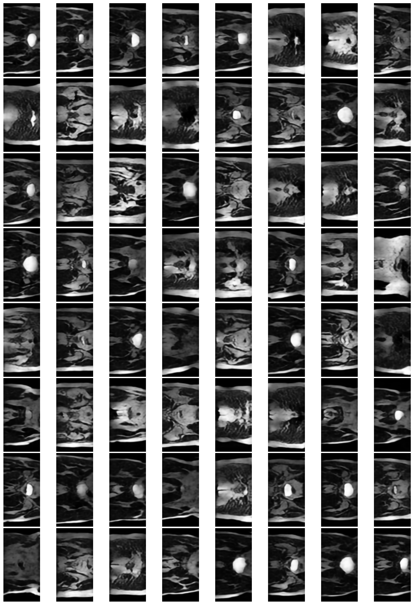
_Figure 26: VQ-VAE - Generated samples after 50 epocs and an additional 15 (stopped early after no improvement) prior epochs_

The revised VQ-VAE demonstrates improved image generation following the architectural changes introduced in Version 7. The generated images contain more recognisable anatomical structures, including more coherent arrangements of surrounding tissue and prominent internal regions. The increased latent resolution appears to improve the representation of finer spatial details.

However, some images continue to exhibit irregularities and inconsistent tissue boundaries. This demonstrates that increasing the model's representational capacity does not guarantee that every generated sample will be anatomically plausible.

The prior was trained for an additional 15 epochs and stopped early when validation performance ceased improving. Early stopping is useful because continued optimisation of training cross-entropy does not necessarily improve the prediction of unseen latent sequences.

Therefore, the value of combining architectural improvements with validation-based checkpoint selection rather than simply maximising the number of training epochs is demonstrated.

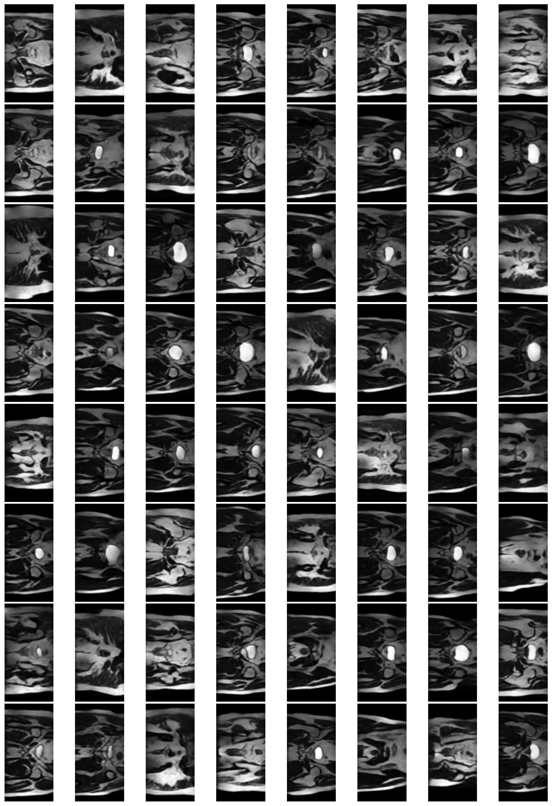
_Figure 27: VQ-VAE - Generated Samples after 50 Epocs and an additional 15 Prior Epochs using option `--ssim-weight 0.1`_

The experiment introduces a structural similarity component into the VQ-VAE training objective using an SSIM weight of 0.1. Unlike MSE, which directly penalises pixel-level intensity differences, SSIM considers similarities in local image structure, luminance and contrast. This makes it particularly useful for medical imaging because preserving tissue boundaries and spatial relationships is often more important than reproducing every individual pixel value exactly.

The generated samples demonstrate more clearly defined anatomical structures and improved visual contrast relative to the preceding experiment. The results suggest that incorporating structural similarity into the training objective can encourage the reconstruction process to preserve more meaningful image characteristics.

However, SSIM should not be treated as a guarantee of anatomical correctness. A structurally similar image may still contain physiologically implausible features, and stronger similarity to training images must not be mistaken for improved privacy. The nearest-neighbour and feature-distribution evaluations are therefore necessary to determine whether the improved visual fidelity is accompanied by acceptable diversity and resistance to memorisation.

## Training

The final comparison evaluates the VAE baseline against the VQ-VAE using the same dataset partitions and corresponding evaluation procedures. Both models were trained for 50 epochs using seed 42. The VQ-VAE configuration incorporates the SSIM-weighted reconstruction objective, while its transformer prior was evaluated separately using validation cross-entropy.

The comparison considers several different aspects of model performance. Reconstruction metrics measure how accurately each model reproduces unseen input images, whereas feature-distribution metrics evaluate how closely newly generated samples resemble the real dataset. Nearest-neighbour comparisons provide an additional assessment of potential memorisation, while resource measurements establish the practical cost of training and generating synthetic samples.

Using these complementary evaluation methods is important because no single metric can establish whether a generative model produces realistic, diverse and privacy-preserving medical images.

### Dependencies

- python 3.14.7
- numpy 2.5.4
- torch 2.14.1
- nibabel 5.4.2
- scikit-image 0.26.0
- scikit-learn 1.9.1
- matplotlib 3.11.2
- torchvision 0.29.2

### Usage Instructions

```shell
# Process NIfTI files to generate manifest.csv
python3 dataset.py audit --data-root /path/to/keras_slices_data --output manifest.csv

# Explore dataset to generate numbers & figures
python3 explore.py --data-root /path/to/keras_slices_data --manifest manifest.csv

# Train VAE and VQ-VAE models
python3 train.py --model vae   --data-root /path/to/keras_slices_data
python3 train.py --model vqvae --data-root /path/to/keras_slices_data --ssim-weight 0.1

# Predict VAE and VQ-VAE models
python3 predict.py --checkpoint runs/vae_seedx42-epochsx50 --top-k 50
python3 predict.py --checkpoint runs/vqvae_seedx42-epochsx50-ssim-weightx0.1 --top-k 50

# Evaluate VAE and VQ-VAE models
python3 evaluate.py \
    --vae-run   runs/vae_seedx42-epochsx50 \
    --vqvae-run runs/vqvae_seedx42-epochsx50-ssim-weightx0.1 \
    --data-root /path/to/keras_slices_data --out evaluation
```

## Training Results & Benchmarking

The final experiments demonstrate that the VQ-VAE provides considerably stronger reconstruction quality and improves the similarity between the generated and real image distributions relative to the VAE baseline. The VAE achieves a held-out reconstruction SSIM of approximately 0.713, exceeding the project's target of 0.6. The VQ-VAE achieves approximately 0.950, demonstrating substantially improved structural reconstruction quality.

However, reconstruction quality alone does not establish generative quality. The generated images must also be evaluated for their similarity to real samples, their diversity and the possibility of training-data memorisation. The feature-distribution results indicate that the VQ-VAE is considerably closer to the real training distribution than the VAE baseline. Nevertheless, its results do not fully match the real held-out reference distribution. The computational comparison also demonstrates a significant trade-off. The VQ-VAE contains more parameters and requires considerably more training time and sampling computation. Its improved quality therefore comes at a higher computational cost.

Overall, the results demonstrate that the VQ-VAE is the stronger model for this experiment, but neither reconstruction quality nor feature-distribution similarity alone is sufficient to establish that its synthetic images are appropriate for clinical or research use.


_Figure 29: Comparision of training curves of both VAE (baseline) and VQ-VAE models_

The training curves provide an overview of model convergence, reconstruction quality, gradient stability, codebook utilisation and learning-rate progression.

The total-loss plot demonstrates that both models learn during training, although their absolute loss values should not be compared directly. The VQ-VAE objective includes additional codebook and commitment losses, whereas the VAE objective includes KL regularisation. Consequently, their total losses represent different optimisation objectives.

The validation SSIM plot provides a more direct comparison of reconstruction quality. Both models improve during training, with the VQ-VAE reaching a substantially higher validation SSIM. This demonstrates the importance of including a structural metric when comparing models trained using different loss formulations.

The reconstruction MSE plot provides complementary information about pixel-level reconstruction error. The VQ-VAE achieves a lower error, indicating that its reconstructions more closely reproduce the original input intensities.

The gradient-norm plot is useful for identifying potential optimisation instability. Large or rapidly increasing gradient norms may indicate unstable updates, whereas a gradual reduction suggests increasingly controlled optimisation. The declining VQ-VAE gradient norm indicates that training becomes more stable over time.

The codebook-usage plot demonstrates that the VQ-VAE uses almost all 512 available codebook entries. This is important because codebook collapse would substantially reduce the model's representational capacity. The perplexity curve provides an additional measure of how evenly the available entries are being used.

Finally, the learning-rate plot demonstrates cosine decay from the initial learning rate towards a lower value. This allows larger parameter updates during the early stages of training and progressively smaller updates as the model approaches convergence.

Together, these plots provide evidence that the models have trained successfully and that the VQ-VAE's improved reconstruction results are not simply the consequence of an unstable or collapsing codebook.


_Figure 30: VQ-VAE - Transformer code prior next-code cross-entropy_

Figure 30 demonstrates the training and validation performance of the autoregressive transformer responsible for generating the VQ-VAE's discrete latent representations.

The training cross-entropy progressively decreases, indicating that the transformer is becoming more effective at predicting the next latent code given the previously generated codes. The validation cross-entropy initially decreases but begins to plateau around epoch 10, with little improvement during subsequent epochs. The best validation checkpoint is therefore identified at approximately epoch 10.

The dotted reference line represents the cross-entropy obtained by uniformly predicting across all 512 available codebook entries. Since a uniform prediction assigns equal probability to every possible code, its cross-entropy is approximately `ln(512)`, or 6.24 nats per code.

Both training and validation losses improve substantially beyond this reference, demonstrating that the transformer has learned meaningful statistical relationships between latent codes.

The increasing separation between training and validation cross-entropy later in training also suggests that additional optimisation provides diminishing generalisation benefits. Selecting the checkpoint based on validation cross-entropy is therefore preferable to using the final training epoch.

This graph is particularly important because the transformer determines how discrete local representations are arranged into complete synthetic images. A codebook may contain realistic anatomical features, but the prior must learn their spatial dependencies to generate coherent images.


_Figure 31 Comparision of error in reconstructions between VAE (baseline) and VQ-VAE models_

Figure 31 presents test images, their corresponding reconstructions and visual error representations for both models. The VAE baseline generally preserves the larger anatomical structures but produces relatively blurred reconstructions. Fine tissue boundaries and smaller local details are less clearly represented. The VQ-VAE reconstructions retain more of the original structural detail and produce lower reconstruction errors. This is consistent with the higher held-out SSIM and lower reconstruction MSE observed in the final comparison.

The error representations are useful because they identify where reconstruction differences occur rather than reducing image quality to a single numerical score. Errors concentrated around tissue boundaries indicate difficulty preserving local anatomical detail, whereas widespread differences suggest that the model is failing to reproduce larger image structures.

The figure therefore provides qualitative evidence supporting the quantitative reconstruction comparison. It also demonstrates why examining spatial error patterns is important in medical imaging: an error affecting a small but anatomically significant boundary may be more consequential than an equivalent error distributed across background pixels.

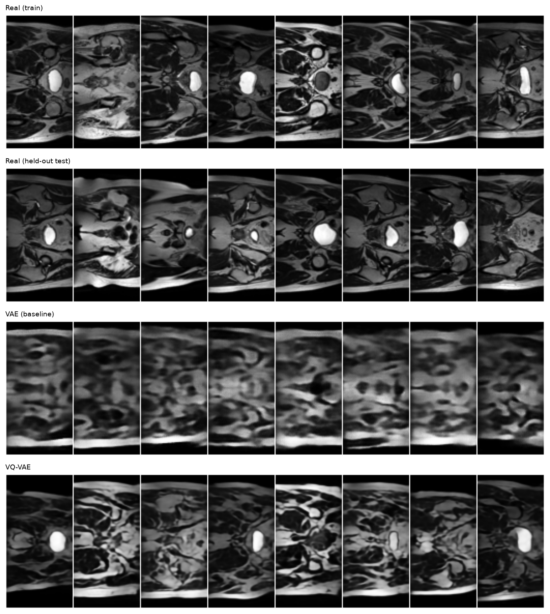
_Figure 32: Comparision of real vs synthetic images generated by both VAE (baseline) and VQ-VAE models_

Figure 32 compares real training images, held-out real images and synthetic images generated by both models. The real images demonstrate the variation in anatomical appearance across the dataset. The VAE-generated samples reproduce some of the overall intensity patterns but exhibit noticeable blurring and loss of fine structural detail.

The VQ-VAE-generated samples retain more clearly defined tissue patterns and generally appear closer to the real images in terms of their local anatomical structure. This visual comparison is important because it provides an initial indication of whether the generated images resemble the intended data distribution. It also helps identify obvious differences that may not be fully captured by reconstruction metrics. However, visual similarity is subjective and cannot establish that the generated images are statistically representative of the real dataset. A model may produce convincing individual examples while generating only a narrow subset of the underlying anatomical variation.

The following nearest-neighbour and feature-distribution analyses are therefore necessary to determine whether these visual improvements are accompanied by sufficient diversity and whether the models reproduce training examples.


_Figure 33: Nearest neighbour audit of both VAE (baseline) and VQ-VAE models_

The nearest-neighbour audit compares generated images against the closest training images using pixel-level mean squared error and structural similarity. This evaluation is important because a generative model could achieve excellent visual quality by reproducing images from its training dataset rather than learning a generalisable representation of the underlying image distribution.

The first plot measures the distance between each generated sample and its nearest training image. The distributions for generated samples are compared against real held-out test images and a training-reconstruction control. The second plot evaluates the best-match SSIM to a training image. Higher similarity indicates greater structural resemblance to an existing training example. The training-reconstruction control provides a useful reference for identifying what an effectively reproduced training image looks like. 

The generated samples have substantially lower similarity to their nearest training images than the training-reconstruction control. Their distance and SSIM distributions are also broadly comparable to those of held-out real samples.

The final scatter plot compares the distance of each generated sample to its nearest training image against its distance to an equally sized unseen test subset. Points below the diagonal indicate samples that are closer to a training image than to a held-out test image. The leaning of points towards being below the line indicate a slight learning of training samples that if more significant could result in a breach of privacy as a result of a learned training sample being reproduced while generating new slices.

The overall results do not demonstrate an obvious systematic reproduction of training images. Nevertheless, this evaluation should be interpreted as evidence against obvious pixel-level copying rather than proof of privacy. Similarity-based analysis cannot rule out all forms of memorisation or patient information leakage.

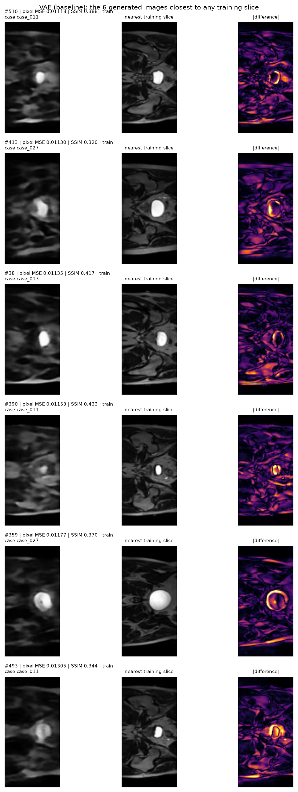
_Figure 34: VAE - Comparison of generated images and their nearest training slice_

Figure 34 presents the VAE-generated images with their closest matching training images and corresponding difference maps. This comparison provides a visual examination of the relationship between generated samples and existing training images. The nearest training image is particularly useful because it represents the most similar example available in the training dataset, making it possible to identify suspiciously close matches.

The examples demonstrate that the VAE can reproduce common anatomical characteristics, including prominent high-intensity structures. However, the difference maps also reveal considerable variations in tissue patterns, boundaries and local image details. This suggests that the generated images are not simply identical copies of the nearest training examples. Nevertheless, the presence of similar anatomical features is expected because the model has learned from a dataset containing recurring anatomical patterns.

The nearest-neighbour comparison is therefore useful for identifying potential memorisation while distinguishing generalised anatomical similarities from unusually close reproductions of individual training images.


_Figure 35: VQ-VAE - Comparison of generated images and thxeir nearest training slice_

The corresponding VQ-VAE analysis demonstrates that its generated images can exhibit greater structural similarity to individual training examples than the VAE samples. The difference maps show that some prominent anatomical structures are closely aligned with those found in the nearest training slices. However, noticeable differences remain in the surrounding tissue patterns, boundaries and local intensity distributions.

This result must be interpreted alongside the quantitative nearest-neighbour distributions. The mean best-match SSIM of the VQ-VAE is approximately 0.341, compared with approximately 0.343 for held-out real images. This indicates that the VQ-VAE's generated samples are not, on average, substantially more similar to training images than genuine unseen samples are.

The analysis is useful because it examines the specific training image most likely to reveal memorisation for each generated sample. However, it cannot independently establish that patient information has not been memorised. A stronger privacy assessment would require additional testing, including patient-level similarity checks and membership-inference analysis.


_Figure 36: Metric comparision of both VAE (baseline) and VQ-VAE models_

The figure compares the models using four complementary groups of metrics: reconstruction SSIM, best-match SSIM to training images, Fréchet distance and precision/recall/density/coverage.

The first chart measures reconstruction SSIM on paired held-out test images. The VAE achieves approximately 0.713, while the VQ-VAE achieves approximately 0.950. Both models exceed the project's target of 0.6, with the VQ-VAE demonstrating considerably stronger structural reconstruction performance. SSIM is useful because it evaluates structural similarity rather than relying exclusively on individual pixel differences. This makes it particularly relevant when assessing whether anatomical structures and local tissue boundaries have been preserved.

The second chart evaluates the best-match SSIM between generated images and real training images. The VAE achieves approximately 0.293, while the VQ-VAE achieves approximately 0.341. The held-out real reference is approximately 0.343. This metric is useful for investigating memorisation. If generated images are substantially more similar to training examples than genuine unseen images are, this may indicate that the model is reproducing training data. The similarity between the VQ-VAE and held-out reference distributions provides encouraging evidence that the generated samples are not exhibiting unusually high similarity to individual training slices.

The third chart presents Fréchet distance using Inception-v3 pooled features. This metric compares the feature distributions of real and generated images, with lower values indicating greater distributional similarity. The VAE obtains a Fréchet distance of approximately 226, compared with approximately 75.14 for the VQ-VAE and 51.59 for the real held-out reference. The VQ-VAE therefore produces a distribution substantially closer to real MRI samples than the VAE baseline. However, it still exhibits a measurable difference from the real reference distribution.

The final chart presents precision, recall, density and coverage. These metrics provide complementary information about the quality and diversity of the generated samples. Precision measures how much of the generated distribution falls within the real-data feature distribution, providing an indication of sample fidelity. Recall evaluates how much of the real-data distribution is represented by generated samples, making it useful for identifying mode collapse. Density measures how densely generated samples occupy regions of the real-data distribution, while coverage assesses how much of that distribution is represented.

The VQ-VAE improves considerably over the VAE baseline across these metrics. Nevertheless, its precision, density and coverage remain below the real reference. Its recall is comparatively high, indicating that it captures a broader range of the real-data distribution despite remaining imperfect in other aspects.

Overall, these measurements demonstrate that the VQ-VAE is substantially more effective than the VAE baseline at generating images that resemble the real dataset. However, the remaining difference from the real reference demonstrates that further improvements are required before the generated dataset can be considered fully representative.

> Note
One important distinction is that the reconstruction SSIM target of 0.6 applies to paired reconstructions, not the best-match SSIM to training images. The two metrics evaluate different properties and should not share the same acceptance threshold.


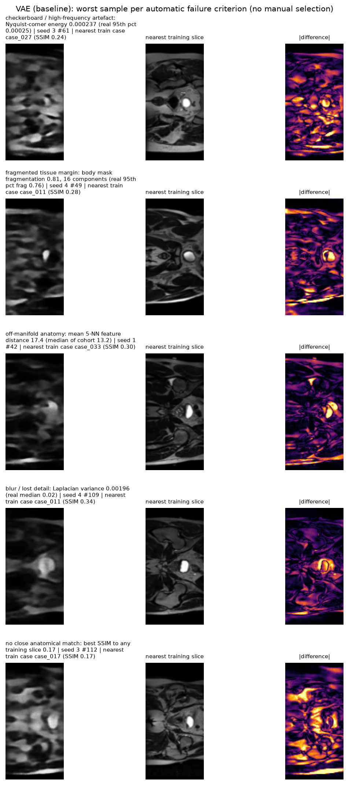
_Figure 37: VAE - autopsy of flawed generations_

The figure presents automatically selected failure cases from the VAE baseline. The examples illustrate several weaknesses in its generated images, including high-frequency artefacts, fragmented anatomical boundaries, off-manifold structures, excessive blurring and poor anatomical correspondence with real training images.

The purpose of the failure analysis is to determine whether the VAE's relatively poor feature-distribution performance is associated with identifiable visual problems. The examples demonstrate that the baseline can produce images containing recognisable MRI-like textures without consistently reproducing realistic anatomical arrangements. In particular, blurred tissue boundaries and fragmented structures reduce the clarity of important anatomical features.

Comparing with the VQ-VAE failure cases also provides a qualitative way to investigate which architectural improvements have addressed particular problems. This analysis is valuable because improving average metrics does not necessarily eliminate the worst failures. Examining automatically selected failure cases provides an additional measure of the reliability of a generative model and helps identify areas requiring further improvement.


_Figure 38: VQ-VAE - autopsy of flawed generations_

Figure 38 presents automatically selected VQ-VAE samples exhibiting different types of generation failures. The examples are selected using quantitative failure criteria rather than manual selection, providing a more systematic way to investigate the model's weaknesses.

The first example demonstrates checkerboard or high-frequency artefacts. These indicate that the model can generate unwanted image patterns that do not correspond to natural anatomical structures. The second example illustrates fragmented tissue margins. This is particularly important for medical images because discontinuities in anatomical boundaries may produce misleading visual information. The third example demonstrates off-manifold anatomy, where the generated image differs significantly from the learned distribution of real MRI images. The nearest training sample and difference map provide context for assessing the extent of the discrepancy. The fourth example demonstrates blur and lost detail. Reduced image sharpness can obscure important tissue boundaries, limiting the usefulness of a synthetic image for downstream medical imaging applications. The final example demonstrates a generated image with no particularly close anatomical match in the training dataset. This provides an example of a potentially unusual or unrealistic output that cannot be easily associated with a known training image.

This analysis is important because average metrics can conceal individual failure cases. Even when a model achieves good average reconstruction and distributional scores, a small number of generated images may still contain substantial artefacts or implausible anatomical structures. Investigating these failures provides information about the specific limitations that must be addressed before synthetic images can be considered suitable for further research.


_Figure 39: t-SNE of Inception-v3 pool features for both VAE (baseline) and VQ-VAE models_

The t-SNE visualisation projects the high-dimensional Inception-v3 feature representations of real and generated images into two dimensions. This technique is useful because feature vectors contain information about the visual characteristics of each image that cannot easily be inspected directly. Reducing them to two dimensions allows the relative distributions of real and generated samples to be examined visually.

The first plot compares all four groups: real training images, held-out real images, VAE-generated images and VQ-VAE-generated images. The real training and testing samples occupy broadly overlapping regions, indicating that the patient-level split retains similar general visual characteristics.

The VAE samples form a more clearly separated cluster from the real images. This indicates a substantial difference between the visual feature distribution learned by the VAE and that of the original dataset. The VQ-VAE samples occupy a region closer to the real-data distribution, although a degree of separation remains. This is consistent with its improved Fréchet distance and precision/recall results.

The comparison provides additional qualitative evidence that the VQ-VAE generates images with more realistic feature characteristics than the VAE baseline. However, t-SNE is a visualisation method rather than a quantitative similarity metric. Its two-dimensional projection can distort distances and cluster relationships. Consequently, overlap between groups should be interpreted as supporting evidence rather than proof that the distributions are identical.


_Figure 40: VAE - Latent interpolation (synthetic sample left, training sample right)_

The figure illustrates the transition between a synthetic sample and a real training sample through interpolation in the VAE's latent space. Each intermediate image is generated by progressively changing the interpolation parameter between the two latent representations. This allows the continuity of the learned latent space to be examined.

The resulting images demonstrate a gradual transition in anatomical appearance rather than an abrupt change between unrelated structures. This suggests that the latent representation captures relationships between different image characteristics and provides a continuous space in which those characteristics can be modified. Latent interpolation is useful because it provides an indication of whether the model has learned an organised representation of anatomical variation. Sudden structural changes or unrealistic intermediate images may suggest that the latent space is poorly organised.

Nevertheless, smooth interpolation does not guarantee that independently generated samples are realistic or privacy-preserving. It evaluates the continuity of the representation between selected endpoints rather than the overall quality of the sampling distribution.


_Figure 41: VQ-VAE - Latent interpolation (synthetic sample left, training sample right)_

The VQ-VAE interpolation demonstrates how its learned representation transitions between synthetic and real image characteristics. Similar to the VAE, the intermediate images provide an indication of whether the latent representation contains meaningful relationships between different anatomical patterns.

The gradual changes in the generated images suggest that the decoder can produce intermediate representations with recognisable tissue structures. This is useful when investigating whether the discrete representation retains sufficient information to describe meaningful anatomical variation.

The comparison with the VAE is particularly relevant because the VQ-VAE uses discrete codes rather than a continuous latent distribution. Its interpolation behaviour therefore provides additional insight into how the quantised representation responds to changes between endpoints. However, a smooth interpolation is not sufficient evidence of realistic generation. The intermediate representations may still contain combinations of structures that would not normally occur in real medical imaging data.

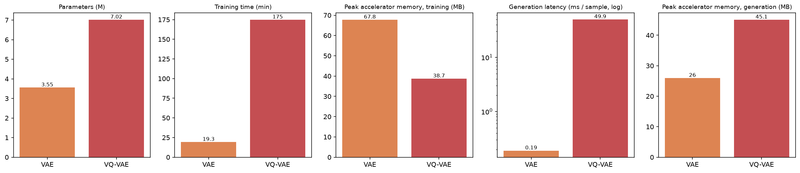
_Figure 42 Resource profile of both VAE (baseline) and VQ-VAE models_

Figure 42 compares the computational requirements of the VAE and VQ-VAE across five measurements: parameter count, training time, peak accelerator memory during training, generation latency and peak accelerator memory during generation.

The parameter-count comparison demonstrates that the VQ-VAE contains approximately 7.02 million parameters, compared with 3.55 million for the VAE. This reflects the additional encoder/decoder complexity and the transformer used to model the discrete latent representation.

Training time is approximately 19.3 minutes for the VAE and 175 minutes for the VQ-VAE. This substantial difference demonstrates the additional computational cost of learning the codebook representation and training the autoregressive prior.

Interestingly, the measured peak accelerator memory during training is approximately 67.8 MB for the VAE and 38.7 MB for the VQ-VAE. During generation, the corresponding measurements are approximately 26 MB and 45.1 MB. These results demonstrate that parameter count alone does not determine memory requirements, since different architectures and execution processes have different memory characteristics.

The most significant difference appears in generation latency. The VAE requires approximately 0.19 ms per sample, compared with approximately 49.9 ms for the VQ-VAE.

This difference is expected because the VAE generates its latent vector directly, whereas the VQ-VAE must generate a sequence of discrete codes using its autoregressive transformer before decoding the image. The sequential generation process introduces additional computation.

These measurements are useful for assessing whether the improved generation quality justifies the additional computational cost. Although the VQ-VAE produces stronger image-quality results, it requires considerably more time to train and generate samples. The resource comparison therefore demonstrates the practical trade-off between model complexity, generation quality and computational efficiency.


```console
Training images  {'active': 512, 'perplexity': 389.12511497261323, 'codes_for_50%': 121, 'codes_for_90%': 359, 'codes_for_99%': 483}
Test images      {'active': 509, 'perplexity': 368.85668977150544, 'codes_for_50%': 109, 'codes_for_90%': 341, 'codes_for_99%': 472}
Prior samples    {'active': 511, 'perplexity': 384.29066857374795, 'codes_for_50%': 118, 'codes_for_90%': 360, 'codes_for_99%': 482}
```
_Figure 43: VQ-VAE - Codebook utilisation distribution_

Figure 43 evaluates how effectively the VQ-VAE uses its 512-entry codebook and whether the autoregressive transformer prior reproduces the distribution of discrete latent codes observed during training. This is important because codebook collapse can substantially reduce the representational capacity of a VQ-VAE. If only a small number of entries are repeatedly selected, the model effectively operates with a much smaller codebook than intended, potentially limiting the anatomical variation it can represent and generate.

The first plot illustrates the frequency of assignments to each code, sorted by training frequency. The training dataset activates all 512 entries, while the held-out test dataset activates 509 and samples generated using the transformer prior activate 511. The distributions follow a similar decreasing pattern, with frequently used codes accounting for a larger proportion of assignments and less frequently used codes forming a long tail. The observed distributions are not uniform, indicating that some latent representations are naturally more common than others. This is expected because certain anatomical structures and image patterns occur more frequently throughout the dataset. Importantly, the distribution does not show a small number of entries dominating almost all assignments, which would indicate a more severe form of codebook collapse.

The second plot presents cumulative code utilisation, showing how much of the total assignment frequency is accounted for by the most frequently used entries. The training distribution requires 359 codes to account for 90% of assignments, compared with 341 for the held-out test images and 360 for prior-generated samples. This corresponds to approximately 70.1%, 66.6% and 70.3% of the available codebook, respectively. The cumulative distributions are considerably more gradual than the uniform reference, demonstrating that code usage is concentrated among more frequently occurring entries. However, a substantial number of additional codes continue contributing to the overall representation. The similarity between the three curves is particularly encouraging because it indicates that the model maintains broadly consistent code utilisation across training images, unseen test images and generated latent sequences.

The final plot directly compares the frequency of individual codes in the training images against their frequency in samples generated by the transformer prior. The dashed diagonal represents perfect agreement between the two distributions. Points close to this line indicate that the prior reproduces the relative frequency of the corresponding code observed during training. Most points lie close to the diagonal, demonstrating that the transformer prior has successfully learned the overall code-frequency distribution. This is important because the prior must learn to generate latent codes that resemble those produced by the encoder, rather than disproportionately selecting certain entries or ignoring representations that occur in real images. There are some deviations, including an individual code that is considerably less frequent in generated samples than in the training distribution. Nevertheless, the overall alignment indicates that there is no substantial systematic mismatch in marginal code usage.

The perplexity values provide an additional measure of codebook utilisation. Perplexity represents the effective number of equally likely code entries implied by the observed assignment distribution. The training images achieve a perplexity of 389, compared with 369 for the held-out test images and 384 for the prior-generated samples. Although all 512 entries are technically available, these values indicate that the effective codebook utilisation is lower because assignment frequencies are not evenly distributed. Nevertheless, the relatively high perplexity values demonstrate that the model makes meaningful use of a substantial proportion of its available representations rather than relying on only a small subset.

Taken together, the results provide encouraging evidence that the VQ-VAE does not exhibit significant codebook collapse. Almost every code is used across the evaluated datasets. This is particularly important for the project's generative objective because the codebook provides the discrete representations from which synthetic images are constructed. Effective utilisation allows the model to represent a wider variety of recurring image features, while accurate reproduction of code frequencies helps the prior generate latent representations that are statistically consistent with those learned by the encoder.

## Final Model Architecture


_Figure 44: Final model architecture_

### Final Model Architectures

### VAE (Baseline): 3,553,889 Trainable Parameters

#### Encoder

The encoder consists of three 4 × 4 convolutions with stride 2, followed by Group Normalisation and SiLU activation. The channel widths increase from 32 to 64 to 128, progressively reducing the spatial dimensions:

`128 × 64 → 64 × 32 → 32 × 16 → 16 × 8`

A final 3 × 3 convolution reduces the feature channels to 32, producing a feature map of shape `32 × 16 × 8`, containing 4,096 values. This feature map is flattened and passed through a fully connected layer that predicts the mean and log-variance of a 256-dimensional Gaussian latent distribution. The log-variance is clamped to the range `[-10, 8]` to prevent numerically unstable variance estimates.

#### Latent Representation and Sampling

During training, latent vectors are sampled using the reparameterisation trick: `z = μ + σ ⊙ ε`, where `ε ~ N(0, I)`.

This allows gradients to propagate through the stochastic sampling process while maintaining a differentiable training objective. During evaluation, the mean `z = μ` is used instead of sampling. This makes reconstruction results deterministic and reproducible.

The training objective combines mean squared error (MSE) reconstruction loss with KL-divergence regularisation: `L_VAE = L_MSE + 0.01 × D_KL / 8192`

The KL term is summed across the latent dimensions and divided by the number of input pixels (8,192). This expresses the regularisation contribution on a per-pixel scale, allowing it to be balanced against the reconstruction loss.

#### Decoder

The decoder maps the 256-dimensional latent vector through a fully connected layer to 4,096 values, which are reshaped into a `32 × 16 × 8` feature map. A 3 × 3 convolution expands the representation to 128 channels, followed by three 4 × 4, stride-2 transposed convolutions that progressively reduce the channel count to 64, 32 and finally 1. The final sigmoid activation constrains the reconstructed image intensities to `[0, 1]`, matching the normalised input data.

#### Generation

The VAE does not contain a separately trained neural-network prior. Instead, after training, a full-covariance Gaussian distribution is fitted to the training-set latent representations and used to generate new latent vectors. This post-hoc distribution is sampled instead of directly sampling from `N(0, I)`, because the aggregate posterior of the trained encoder does not necessarily match the standard normal distribution exactly. Generated latent vectors are passed through the decoder in a single forward pass.

#### Parameter Distribution

The two fully connected layers connecting the spatial feature representation to the global latent vector account for approximately 88.6% of the model's trainable parameters. The convolutional encoder and decoder are comparatively small. Consequently, most of the VAE's parameters are concentrated in the fully connected bottleneck rather than the convolutional feature-extraction stages. This is a consequence of flattening the spatial feature map and connecting every spatial feature to the global latent representation.

### VQ-VAE (Selected Model): 7,016,961 Trainable Parameters

The VQ-VAE consists of two separately trained components: a convolutional autoencoder with a discrete latent bottleneck and an autoregressive transformer code prior.

#### 1. Convolutional Autoencoder: 2,003,201 Trainable Parameters

**Encoder**

The encoder begins with a 3 × 3 convolution that produces 32 feature channels, followed by a residual block.

Two 4 × 4, stride-2 convolutions progressively increase the channel count to 64 and then 128 while reducing the spatial dimensions: `128 × 64 → 64 × 32 → 32 × 16`

Each downsampling stage is followed by a residual block. At the bottleneck, two additional residual blocks process the 128-channel feature representation. Group Normalisation and SiLU activation are applied before a final 1 × 1 convolution reduces the channel dimension to 64.

The resulting encoder representation, `z_e`, has shape: `64 × 32 × 16`

Unlike the VAE's single global latent vector, this representation retains a spatial grid of 32 × 16 positions, preserving the spatial organisation of the encoded image. Each residual block consists of two units, each containing Group Normalisation, SiLU activation and a 3 × 3 convolution, with an identity skip connection around the block. These connections improve information and gradient propagation through the network.

**Vector Quantisation**

The encoder representation contains 512 spatial positions, each represented by a 64-dimensional vector.

Each encoder vector is assigned to its nearest entry in a learned codebook containing 512 vectors of dimension 64. The nearest entry is selected using squared Euclidean (L2) distance: `k* = argmin_k ||z_e - e_k||²`

The resulting quantised representation has the same spatial dimensions as the encoder output, but each position is replaced by its selected codebook vector. The quantiser uses a straight-through estimator during backpropagation. The forward pass uses the quantised representation, while the backward pass propagates decoder gradients directly to the encoder representation, bypassing the non-differentiable nearest-neighbour selection.

The codebook is updated using exponential moving averages (EMA) of code assignments and their corresponding encoder outputs, with a decay of 0.99. Data-dependent initialisation and re-seeding of inactive entries are also used to reduce the likelihood of dead codes. Because EMA updates are used, the codebook does not receive conventional optimiser gradients. Its 32,768 values are therefore excluded from the reported trainable parameter count, although they remain learned model state.

**Decoder**

The decoder begins with a 3 × 3 convolution that expands the quantised representation to 128 channels, followed by two residual blocks. Two upsampling stages progressively restore the original resolution. Each stage uses nearest-neighbour upsampling by a factor of two, followed by a 3 × 3 convolution and a residual block. The channel count decreases from 128 to 64 and then 32. Finally, Group Normalisation and SiLU activation are applied, followed by a 3 × 3 convolution producing a single output channel and a sigmoid activation.

Nearest-neighbour upsampling followed by convolution is used instead of transposed convolutions. This avoids the uneven-overlap patterns associated with transposed-convolution checkerboard artefacts and provides a more controlled reconstruction process.

**Training Objective**

The VQ-VAE uses a combination of pixel-level reconstruction, structural similarity and commitment losses: `L_VQ = L_MSE + 0.1 × (1 - SSIM) + 0.25 × L_commitment`

MSE encourages accurate reproduction of pixel intensities, while the SSIM component encourages preservation of local image structure, luminance and contrast. The commitment loss encourages encoder outputs to remain close to their assigned codebook vectors, preventing the encoder from continually moving its representations away from the available discrete entries. The codebook-error term is also calculated for monitoring, but does not contribute an optimiser gradient because the codebook is updated using EMA.

#### 2. Autoregressive Transformer Code Prior: 5,013,760 Trainable Parameters

**Architecture**

The transformer learns the probability distribution of the discrete latent codes produced by the trained autoencoder. The `32 × 16` latent grid is flattened into a sequence of 512 tokens in raster order. Each token represents one of the 512 available codebook entries.

The input representation combines three embeddings:

- A learned token embedding representing the selected codebook entry.
- A learned row embedding identifying the token's vertical position.
- A learned column embedding identifying its horizontal position.

A learned beginning-of-sequence (BOS) token is also used, with the input sequence shifted to implement next-token prediction.

The transformer consists of six pre-LayerNorm blocks. Each block contains:

- Causal self-attention with eight attention heads.
- A GELU-activated feed-forward network with dimensions `256 → 1024 → 256`.
- Dropout with probability 0.1.

A final LayerNorm and linear projection produce 512 logits, representing the probability distribution over the available codebook entries for the next token. Causal attention ensures that each position can only attend to preceding tokens. This allows the model to learn the conditional probability of each code given the previously generated codes. The learned row and column embeddings provide spatial information that would otherwise be lost when the two-dimensional latent representation is flattened into a sequence.

**Training**

The prior is trained separately after the autoencoder using code maps extracted from the training split. Its objective is next-token cross-entropy: `L_prior = -Σ log P(k_i | k_1, ..., k_(i-1))`

Training uses AdamW with an initial learning rate of `5 × 10⁻⁴`, warm-up and cosine learning-rate decay. Early stopping is based on validation cross-entropy, selecting the checkpoint that best predicts previously unseen latent code sequences rather than simply minimising training loss.

**Generation**

Generation begins with the learned BOS token. The transformer then predicts the 512 codebook indices sequentially, conditioning each prediction on the previously generated tokens. A key/value cache is used during sampling to avoid recalculating attention representations for all preceding tokens at every generation step. Temperature scaling and optional top-k sampling are available to control the diversity of the generated code sequences.

Once all 512 codes have been generated, they are converted into their corresponding codebook vectors and passed through the VQ-VAE decoder to produce the final MRI image. Consequently, generating an image requires 512 autoregressive transformer prediction steps followed by one decoder forward pass.

#### Parameter Distribution and Computational Cost

The complete VQ-VAE generator contains:

| Component | Trainable parameters |
|---|---:|
| Convolutional autoencoder | 2,003,201 |
| Transformer prior | 5,013,760 |
| **Total** | **7,016,961** |

The transformer prior accounts for approximately 71.4% of the complete model's trainable parameters. Its additional complexity is required to model the conditional relationships between the 512 spatially arranged latent codes. Within the autoencoder, approximately 63% of the trainable parameters are concentrated in the two bottleneck stages, with approximately 30% in the encoder and 33% in the decoder. The remaining parameters are distributed across the convolutional stages. Although the transformer introduces substantial additional complexity, it provides the mechanism required to learn how local codebook representations should be arranged to generate complete images.

### Side-by-Side Architecture Comparison

| Property | VAE (Baseline) | VQ-VAE (Selected) |
|---|---|---|
| Latent representation | 256-dimensional continuous vector | 512 discrete tokens arranged in a 32 × 16 grid |
| Latent information | 256 continuous values | 512 indices, with 9 bits per index (4,608 nominal bits) |
| Spatial information | Compressed into a global vector | Retained in a spatial latent grid |
| Latent dimensionality | 256 | 64 values per quantised code; 512 code positions |
| Codebook | None | 512 entries, each 64-dimensional |
| Autoencoder trainable parameters | 3,553,889 | 2,003,201 |
| Additional learned components | Fitted full-covariance Gaussian prior | 5,013,760-parameter transformer prior |
| EMA codebook values | None | 32,768 |
| Total trainable parameters | 3,553,889 | 7,016,961 |
| Parameter concentration | 88.6% in two fully connected layers | 63% in the encoder and decoder bottleneck stages |
| Decoder upsampling | Transposed convolutions | Nearest-neighbour upsampling followed by convolution |
| Latent sampling | Sample from fitted Gaussian | Autoregressive discrete-code sampling |
| Image generation | One decoder forward pass | 512 prior steps followed by one decoder pass |
| Main architectural risks | Blurring and limited representational capacity | Codebook collapse, prior overfitting and incorrect spatial code arrangements |

### Architectural Trade-off and Design Justification

The VQ-VAE autoencoder contains approximately 44% fewer trainable parameters than the VAE baseline: `((3,553,889 - 2,003,201) / 3,553,889) × 100 ≈ 43.6%`

Despite being smaller, the VQ-VAE autoencoder retains a spatial latent representation rather than compressing the entire image into a single global vector. This preserves the spatial organisation of the encoded features and allows the decoder to reconstruct local anatomical details from the quantised representation. However, the reduction in autoencoder parameters does not make the complete VQ-VAE smaller. Its transformer prior increases the total parameter count to 7,016,961, nearly twice that of the VAE baseline. This additional complexity serves a different purpose: the autoencoder learns reusable discrete representations of image features, while the transformer learns how those representations should be spatially arranged to generate new images. The architectural trade-off is therefore between a relatively compact continuous latent model with inexpensive sampling and a more expressive discrete latent model with a substantially more expensive autoregressive generator.

The experimental results justify the additional complexity of the VQ-VAE for this project. Its spatially structured latent representation and learned code prior produce substantially better reconstruction quality and more realistic generated images than the baseline. Nevertheless, the higher training and generation costs must be considered when evaluating its practical suitability.

## Final Generated Images


_Figure 45: VAE - Generated samples_


_Figure 46: VQ-VAE - Generated samples_

## Final Discussion and Limitations

This project investigated whether a Vector-Quantised Variational Autoencoder (VQ-VAE) could generate realistic and diverse synthetic HipMRI images while reducing the likelihood of reproducing individual training images. A Variational Autoencoder (VAE) was implemented as the baseline to evaluate whether the additional representational capacity and autoregressive sampling mechanism of the VQ-VAE provided meaningful improvements.

Overall, the experimental results demonstrate that the VQ-VAE outperforms the VAE baseline in reconstruction quality and in several measures of generated-image fidelity and distribution similarity. However, these improvements come at the cost of increased model complexity, training time and generation latency.

### Generated Image Quality and Distribution Similarity

The generated-sample grids demonstrate that the VAE produces recognisable MRI-like images but frequently exhibits blurred anatomical structures and inconsistent tissue boundaries. The VQ-VAE produces considerably more coherent images with sharper structures and a closer visual resemblance to real scans.

The quantitative distribution metrics support these observations. The VQ-VAE achieves a Fréchet distance of approximately 75.14, compared with approximately 226 for the VAE baseline and 51.59 for the held-out real-data reference. Since lower Fréchet distance indicates greater similarity between feature distributions, the results demonstrate that the VQ-VAE generates samples substantially closer to the real dataset than the baseline.

The precision, recall, density and coverage measurements provide additional information about the generated distributions. Precision indicates whether generated samples occupy regions associated with real images, whereas recall assesses how much of the real-data distribution is represented by the generated samples. Density and coverage provide further information about how generated samples populate the real-data feature space.

The VQ-VAE improves considerably over the baseline, particularly in its ability to represent the real-data distribution. Its relatively strong recall indicates that it captures a broader range of real-data characteristics. However, its remaining differences in precision, density and coverage demonstrate that the generated distribution is not yet equivalent to that of genuine MRI images.

This distinction is important because a generative model could produce several visually convincing images while repeatedly generating only a limited subset of the underlying anatomical variation. Evaluating the distribution as a whole provides a stronger indication of representativeness than selecting a few favourable examples.

### Diversity and Memorisation

The nearest-neighbour evaluation investigates whether generated images are unusually similar to individual training examples. This is particularly important for medical imaging because a model that reproduces patient scans may create privacy risks when synthetic images are distributed outside their original clinical environment.

The VQ-VAE achieves a mean best-match SSIM to training images of approximately 0.341, compared with approximately 0.343 for the held-out real reference. This similarity suggests that generated images are not, on average, substantially closer to training examples than genuine unseen images are. The nearest-neighbour examples also demonstrate differences between generated samples and their closest training images. These results provide encouraging evidence against obvious image-level copying.

However, similarity measurements cannot establish that patient-specific information has not been memorised. A generative model may retain identifying characteristics without producing an almost identical copy of an original image. Consequently, the nearest-neighbour analysis should be interpreted as an initial memorisation assessment rather than a formal privacy guarantee.

The use of multiple random seeds and uncurated generated-sample grids also provides evidence that the models can produce variation between samples. Nevertheless, a more comprehensive diversity evaluation would be required to establish that the complete range of real anatomical variation is represented.

### Computational Efficiency and Practical Trade-offs

The experimental results demonstrate that the VQ-VAE's improvements require considerably greater computational resources. The VAE contains approximately 3.55 million parameters, compared with approximately 7.02 million for the VQ-VAE. Training the VQ-VAE requires approximately 175 minutes, compared with approximately 19.3 minutes for the VAE. Generation latency also differs substantially. The VAE generates a sample in approximately 0.19 ms, whereas the VQ-VAE requires approximately 49.9 ms. This difference is primarily attributable to the autoregressive transformer, which must predict a sequence of discrete latent codes before the decoder can reconstruct the final image.

This trade-off is important when considering practical deployment. Although the VQ-VAE provides considerably better image quality, its sequential sampling process makes it less computationally efficient than the baseline. For relatively small synthetic cohorts, this additional cost may be acceptable. However, generating very large datasets would benefit from further optimisation of the prior and sampling procedure.

The resource measurements also demonstrate that model parameter count does not directly determine peak accelerator memory consumption. The two models exhibit different memory requirements during training and generation because their architectures and execution procedures differ. Overall, the VQ-VAE represents a more computationally demanding but substantially more capable generative architecture for the selected task.

## Limitations

Despite the improvements demonstrated by the VQ-VAE, several limitations restrict the conclusions that can be drawn from the experiments.

### Dataset Size and Generalisation

The original dataset contains 38 patients, with 31 assigned to training, four to validation and three to testing. Although the dataset contains thousands of individual slices, the number of independent patients is relatively small. Patient-level splitting prevents slices from the same patient appearing in multiple partitions, reducing the risk of data leakage. However, the small number of held-out patients limits the strength of conclusions about generalisation to previously unseen individuals. Furthermore, the dataset is specific to HipMRI and does not establish that the model will generalise to other anatomical regions, MRI acquisition protocols or clinical institutions. Additional data from independent patients and imaging centres would be necessary to establish whether the learned representation generalises beyond the original dataset.

### Two-Dimensional Image Generation

The project generates individual 2D MRI slices rather than complete 3D medical volumes. Although the model can learn the anatomical appearance of individual slices, it does not explicitly enforce continuity between adjacent slices. Consequently, independently generated images may contain structures that would not remain anatomically consistent when arranged into a three-dimensional volume. This limits the applicability of the generated images to tasks requiring volumetric anatomical consistency. A future implementation could investigate a three-dimensional generative architecture or introduce explicit relationships between adjacent slices.

### Preprocessing and Loss Functions

Per-slice percentile normalisation improves training stability by reducing the influence of extreme intensities and differences in absolute signal magnitude. However, this approach removes information about absolute MRI intensity. Consequently, the generated images cannot be assumed to preserve the original quantitative signal characteristics of real scans. The reconstruction objective also introduces limitations. Although MSE and SSIM encourage accurate reconstruction and structural preservation, neither metric directly evaluates physiological correctness. The frequency-domain analysis demonstrates that even when reconstruction and SSIM results are strong, differences in image sharpness and high-frequency information can remain. Additional perceptual, anatomical and domain-specific evaluation methods would therefore be beneficial.

### Limitations of Evaluation Metrics

The evaluation uses several complementary metrics, but each has limitations. SSIM primarily measures structural similarity and does not establish whether anatomical structures are physiologically valid. Fréchet distance and precision/recall/density/coverage provide information about feature distributions, but their conclusions depend on the feature representation used. In particular, Inception-v3 features are not specifically designed for MRI anatomy. Their similarity measurements may capture general visual characteristics without adequately representing clinically significant anatomical differences. The frequency-domain and Laplacian measurements provide additional information about image sharpness and artefacts but cannot independently establish anatomical correctness. In particular, checkerboard energy is not a definitive detector of generated-image defects, since natural high-frequency structures can also contribute to the measured energy.

The current evaluation should therefore be understood as a combination of quantitative image-quality measurements and visual inspection rather than a complete assessment of clinical image validity.

### Privacy and Memorisation

The nearest-neighbour analysis provides encouraging evidence that the VQ-VAE does not simply reproduce its training images. However, it does not constitute a formal privacy assessment. The models have not been established as differentially private, and no formal membership-inference or patient re-identification evaluation has been demonstrated. Consequently, the generated images cannot be assumed to be anonymous or safe for unrestricted distribution solely because their nearest training images exhibit measurable differences. Further privacy testing would be required before considering the generated dataset suitable for sharing outside the original research environment.

### Anatomical Validity and Clinical Utility

Although the VQ-VAE produces more realistic-looking images than the baseline, the generated samples still exhibit occasional artefacts and differences from real MRI images. The project does not include formal expert clinical validation or demonstrate that the generated images preserve all anatomically significant structures. Furthermore, the experiments do not establish whether synthetic images improve the performance of downstream medical imaging tasks. A visually convincing synthetic image may still contain misleading structures that negatively affect a model trained using it.

A future evaluation should investigate downstream utility by training a segmentation or other medical imaging model using real images alone and comparing it against a model trained using real images supplemented with synthetic samples. Both models should then be evaluated exclusively on held-out real patients. This would establish whether synthetic images provide practical benefits rather than merely improving visual similarity metrics.

## Conclusion

### Key Results

| Metric | VAE (Baseline) | VQ-VAE |
|---|---:|---:|
| Reconstruction SSIM | 0.713 | **0.950** |
| Fréchet Distance (lower is better) | ~226 | **75.14** |
| Best-match SSIM to Training Images | 0.293 | 0.341 |
| Trainable Parameters | 3,553,889 | 7,016,961 |
| Training Time | 19.3 min | 175 min |
| Generation Latency | 0.19 ms | 49.9 ms |

| VQ-VAE Metric | Training | Held-out Test | Prior-Generated |
|---|---:|---:|---:|
| Active Codebook Entries | 512/512 | 509/512 | 511/512 |
| Codebook Perplexity | 389 | 369 | 384 |

**Key Findings**
- Both models exceed the target reconstruction SSIM of 0.6.
- VQ-VAE achieves substantially better reconstruction quality and feature-distribution similarity.
- VQ-VAE demonstrates effective codebook utilisation without evidence of severe codebook collapse.
- Nearest-neighbour results show no obvious systematic reproduction of training images.
- VQ-VAE requires approximately 9.1× longer training and 263× higher generation latency than the VAE.

### Final Words

The experimental results demonstrate that the VQ-VAE is the stronger of the two evaluated generative architectures for the selected HipMRI dataset. Its discrete latent representation, finer spatial encoding, residual encoder-decoder and autoregressive transformer provide a more effective mechanism for learning and generating anatomical image structures than the compact continuous latent representation of the VAE baseline.

The VQ-VAE achieves substantially higher reconstruction SSIM, improved feature-distribution similarity and greater preservation of high-frequency image information. The frequency-domain and sharpness analysis provides further evidence that its generated images are less blurred and more closely resemble real MRI images.

However, these improvements come at the cost of increased computational requirements, and the generated distribution still differs from the real-data reference. The nearest-neighbour analysis provides encouraging evidence against obvious image-level memorisation, but does not establish formal patient privacy. Similarly, the quantitative metrics and visual results do not establish clinical validity or downstream research utility.

Therefore, the VQ-VAE successfully demonstrates the potential of discrete latent representations for synthetic HipMRI generation and provides a stronger solution than the implemented VAE baseline. Nevertheless, additional patient-level evaluation, anatomical validation, privacy testing and downstream utility experiments would be required before the generated images could be recommended for use in real medical imaging research.

The final engineering recommendation is to retain the VQ-VAE as the preferred experimental architecture while treating its generated images as research prototypes rather than clinically validated or privacy-guaranteed synthetic medical data.

## AI Disclosure

### Which AI tools were utilized:

Claude (Anthropic) was used throughout this project to assist in the generation of code for the models, figures and results mentioned throughtout this report based on human decisions as described by the changelog. ChatGPT was used in explaing concepts and results where no code needed to be generated.

### What specific tasks AI assisted with:

1. Initial scaffolding and implementation of `modules.py` and `dataset.py`, and the `train.py` training loop base on desisions made in the initial feasability specification.
2. Iterations on the initial model designs including converting the baseline model from an AE to VAE.
3. The production of tools such as `explore.py`, `evaluate.py` and its helps to assist in diagnosing problems and benchmarking solutions such that future decisions and analysis can be confidently made.
4. Constructing `predict.py` as well as drafting much of the initial feasability report/
5. Drafting this README report based on visual and quantitaive data produced by the model.
6. Explaning core concepts throught the entire process to provide an overview of the specific concept, such as Autoencoders, codebook collapse ot SSIM, for consolation rather than reading in depth scientific papers.

### How AI-suggested code was audited, verified, and empirically tested:

All code was manually reviewed ensuring that there were no obvious bugs or inaccuracies while ensuring strict version control so, that if any issues were later found to be introduced by the foreign code, changes can be rolled back to the last stable version. The models were then verified based on visual sample reconstruction and generations to ensure that the outputed samples match what is suggested by the numerical results. Finally, solutions to issues proposed to the AI model where tested to determing wheither the casue of the issue was identified or whether the changes made did not address the original issue. The original figures were refenced to ensure that all results matched the model output rather than being haloosinated by the LLM.

## References

1. PyTorch Team. (2026). PyTorch Documentation (Version 2.14). https://docs.pytorch.org/docs/2.14/index.html
2. The University of Queensland. (2026). COMP3710 Pattern Recognition and Analysis: Report specification (v2.3), Appendix: HipMRI Study for prostate cancer radiotherapy dataset and Appendix B (Nifti loading code).
3. van den Oord, A., Vinyals, O., & Kavukcuoglu, K. (2017). Neural discrete representation learning. Advances in Neural Information Processing Systems, 30.
4. Wang, Z., Bovik, A. C., Sheikh, H. R., & Simoncelli, E. P. (2004). Image Quality Assessment: From Error Visibility to Structural Similarity. IEEE TIP.
