# Generating Synthetic HipMRI Slices with a VQ-VAE and Autoregressive Prior

**Difficulty:** Hard

**Student ID:** s4884249

## 1. Project Overview

Medical-imaging research is limited by patient-data privacy requirements and the availability of clinical scans. Synthetic images could support research and data augmentation, but only if they retain useful anatomical structure, provide diversity, and do not reproduce identifiable training examples.

This project develops a **Vector-Quantised Variational Autoencoder (VQ-VAE)** to generate synthetic 2D HipMRI slices from `keras_slices_data`. A **Variational Autoencoder (VAE)** is the generative baseline. The investigation asks whether discrete spatial representations and an autoregressive prior improve image fidelity and distribution coverage without causing codebook collapse, implausible anatomy, or obvious training-image memorisation. The intended users are medical-imaging researchers and machine-learning engineers evaluating synthetic scans for research use; the outputs are not intended for clinical use.

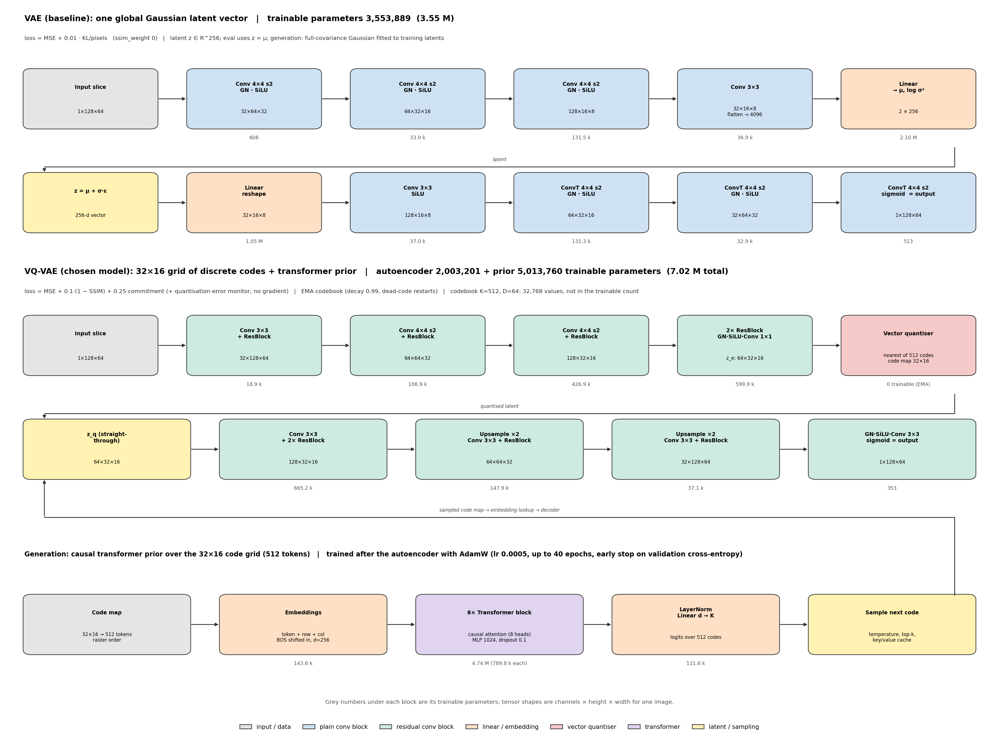

_Figure 1: Baseline VAE and selected VQ-VAE architecture._

## 2. Feasibility Review

### User need

Medical imaging research is constrained by stringent patient data privacy laws (HIPAA, GDPR) and limited clinical scan availability. Generative models allow synthesizing realistic synthetic cohorts for data augmentation and anonymized multi-centre sharing. However, healthcare synthesis carries unique hazards: the model must preserve authentic physiological tissue boundaries without mode collapse, and must not hallucinate anatomically impossible structures or memorize training scans (which would violate patient confidentiality).

The intended user is a medical imaging researcher or machine learning engineer evaluating whether synthetic images can supplement real HipMRI data. The prototype will implement a Vector-Quantised Variational Autoencoder (VQ-VAE) to generate synthetic 2D HipMRI slices and investigate the trade-off between image fidelity, sample diversity, and memorization of training data.

The key dilemma is determining whether scans that are anatomical valid without becoming blurry or facing mode collapse, hallucinating physiologically impossible tissue junctions or non-existent pathologies and without producing verbatim memorization of training patient scans.

If a generative model simply memorizes training scans, sharing the synthetic dataset constitutes an illegal breach of patient confidentiality. However, if it hallucinates unrealistic tissue structures, downstream models trained on it will learn hazardous diagnostic artefacts.

### Scope

The project is scoped to 2D HipMRI image generation using the provided `keras_slices_data` dataset. It will compare VQ-VAE against a simpler autoencoder baseline under consistent data splits and evaluation conditions.

### Acceptance criteria

The prototype is limited to 2D HipMRI generation. Both models use the same patient-level data partitions and evaluation procedures.

- [x] Train a VQ-VAE that reconstructs HipMRI slices.
- [x] Generate new samples by sampling discrete latent codes from a learned prior.
- [x] Exceed the SSIM target of `0.6` on held-out paired reconstructions.
- [x] Achieve an SSIM similar to that of held-out references in generated samples.
- [x] Compare the VQ-VAE with a simpler generative baseline using the same data splits.
- [x] Inspect uncurated samples, latent interpolations, and nearest training neighbours for diversity, anatomical plausibility, and possible memorisation.
- [x] Measure parameter count, training time, peak accelerator memory, and generation latency.

### Dataset Configuration

**Data:** HipMRI 2D slices

The project will use the provided HipMRI 2D slices from keras_slices_data, available through the COMP3710 project environment. Images will be loaded, checked for corrupted or inconsistent dimensions, and normalized to a consistent intensity range suitable for the selected reconstruction loss.

The dataset will be divided into training, validation, and test sets before model training. Where patient identifiers or source-volume information are available, slices from the same patient or volume will be kept within a single split to reduce data leakage. The training set will be used to learn model parameters, the validation set to select configurations and checkpoints, and the test set reserved for final evaluation.

### Model Architecture and Difficulty

**Model:** Vector-Quantised Variational Autoencoder (VQ-VAE) + Autoregressive Prior

**Difficulty band:** Hard Difficulty

VQ-VAE uses an encoder to map an image into a lower-dimensional latent representation. The representation is quantized by assigning latent vectors to entries in a learned discrete codebook. A decoder then reconstructs the image from the quantized representation. The training objective combines reconstruction loss with terms that train the codebook and encourage the encoder to use its discrete representations effectively.

The discrete latent representation provides a way to learn recurring image structures, but it can also introduce reconstruction artefacts or under-use of the codebook. These behaviours will be investigated through reconstruction comparisons, codebook usage statistics, and generated sample grids.

Using PyTorch, the architecture will begin with a relatively small convolutional encoder and decoder, with the latent dimensionality, codebook size, and reconstruction objective selected to suit the resolution and characteristics of the dataset.

### Relevant Course Concepts and Literature

The project applies convolutional neural networks, representation learning, encoder-decoder architectures, reconstruction losses, latent representations, optimization, validation, and quantitative model evaluation.

The assessment specification identifies VQ-VAE as a Hard Difficulty model for HipMRI 2D slices and cites "Neural discrete representation learning" by NeurIPS (2017). A basic autoencoder will provide the required simpler generative baseline. The comparison will examine whether discrete latent quantization provides useful improvements in image structure and diversity relative to the simpler model.

The central research question is whether VQ-VAE can generate anatomically plausible and sufficiently diverse synthetic images without reproducing training examples. The final recommendation will be based on experimental evidence rather than visual quality alone.

### Preliminary evidence

The initial Rangpur audit inspected `25,320` NIfTI files. All were readable `float32` files with finite voxel values. The raw dimensions were `256 × 128` for `25,200` files and `256 × 144` for `120` files; the observed intensity range was `[0, 1212]`. The directory contained both MRI images and segmentation masks, so image/mask classification and patient-level grouping were required before training.

A small deterministic autoencoder smoke test verified loading, forward and backward passes, finite losses, GPU execution, reconstruction, and checkpoint save/load. It preserved large anatomical features but blurred fine detail. This established that the pipeline worked; it did not establish generative ability, because a deterministic autoencoder does not learn a sampling distribution. The final baseline was therefore upgraded to a VAE.

The initial compute plan reserved **6–12 GPU** for data preparation, smoke tests, experiments, and final evaluation. This was a planning estimate, not a measured runtime. The final measured training times are reported in Section 7.

### Main risks and fallback

| Risk | Mitigation or fallback |
|---|---|
| Poor reconstruction or unstable training | Inspect validation curves and image grids; verify scaling and losses; reduce resolution, channel widths, or epochs. |
| Codebook collapse | Monitor active entries and perplexity; adjust codebook size and optimisation. |
| Training-image memorisation | Keep patient splits isolated and audit nearest training neighbours. |
| Mode collapse or limited diversity | Inspect uncurated samples across multiple random seeds and compare feature-space coverage. |
| Excessive memory or runtime | Start with compact models, profile each execution stage, and reduce model capacity if required. |
| Unreliable comparisons | Use the same manifest, patient partitions, and held-out test set; report reconstruction and generation metrics separately. |

If quantisation remains unstable, the VAE remains a functioning generative baseline for diagnosing the failure. Poor samples are not treated as successful merely because the model produces images; the final recommendation depends on fidelity, diversity, memorisation checks, and measured resource use.

## 3. Dataset and Preprocessing

The dataset contains HipMRI 2D slices and corresponding segmentation masks. Generation uses the MRI images; the masks are retained for audit and pairing checks, not as model targets. The manifest contains `12,660` image-mask pairs across `38` patient cases. Its partitions are `11,460` training, `660` validation, and `540` test images, with `31`, `4`, and `3` patients respectively. No patient appears in more than one split.

The loader keeps the standard `256 × 128` geometry and excludes the `60` MRI slices with `256 × 144` geometry. This leaves **12,600 model images** with a consistent aspect ratio. The final pipeline downsamples these slices to `1 × 128 × 64` model inputs while preserving the source aspect ratio.

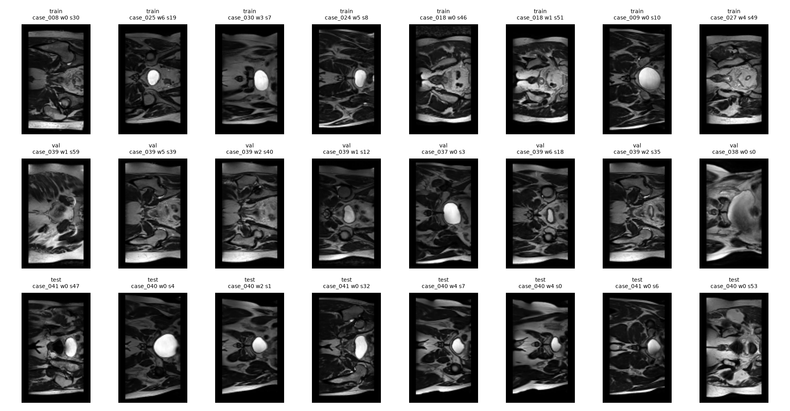

_Figure 2: Representative slices from the training, validation, and test partitions._

### Preprocessing

In `normalize_mri` from `dataset.py`, each slice is clipped to its 1st and 99.5th intensity percentiles, then scaled to `[0, 1]`:

```python
"""Per-slice scaling to [0, 1] after clipping to the 1st-99.5th percentile.

Clipping stops a few very bright voxels from compressing the useful range, and
per-slice scaling removes the arbitrary absolute intensity scale between scans.
"""
low, high = np.percentile(array, [1.0, 99.5])
if high <= low:
    # constant slice: nothing to scal
    return np.zeros_like(array, dtype=np.float32)
return ((np.clip(array, low, high) - low) / (high - low)).astype(np.float32)
```

The manifest loader excludes masks, unreadable files, non-standard shapes, constant slices, and (when configured) slices below a minimum non-zero-pixel fraction. Per-slice normalisation reduces the influence of extreme intensities and between-scan scale variation, but removes absolute signal information. Generated intensities therefore must not be interpreted as quantitative MRI measurements.

Patient-level splitting is essential because slices from the same patient are correlated. A random slice-level split could place near-duplicate anatomy in training and test partitions and inflate results. The visual partition check shows broadly similar anatomical content, but does not prove statistical equivalence between the patient groups. The small number of held-out patients also limits generalisation claims.

## 4. Model Design

**Selected model:** VQ-VAE with a causal-transformer prior  
**Difficulty:** Hard  
**Generative baseline:** VAE

### VAE baseline

The VAE encoder uses three stride-2 convolutional stages with Group Normalisation and SiLU, reducing a `1 × 128 × 64` slice to a feature map that is projected to a 256-dimensional Gaussian latent distribution. Training samples from this distribution using the reparameterisation trick; reconstruction at evaluation uses the latent mean. Its objective is:

```text
L_VAE = L_MSE + 0.01 * D_KL / 8192
```

For generation, a full-covariance Gaussian is fitted to training-set latent vectors and sampled before a single decoder pass. This provides a more useful sampling distribution than the unregularised latent space of the initial deterministic autoencoder.

### VQ-VAE autoencoder and codebook

The VQ-VAE encoder produces a `64 × 32 × 16` latent tensor: a `32 × 16` spatial grid with 64 features per position. Each of the 512 vectors is replaced by its nearest entry in a learned codebook of 512 64-dimensional vectors. A straight-through estimator passes decoder gradients to the encoder, while exponential moving averages (EMA, decay `0.99`) update codebook entries. Data-dependent initialisation and inactive-code restarts reduce dead-code problems.

The decoder maps the quantised grid back to a `1 × 128 × 64` image. Residual blocks support feature learning, and nearest-neighbour upsampling followed by convolution avoids the uneven-overlap patterns associated with transposed-convolution upsampling. The reconstruction objective is:

```text
L_VQ = L_MSE + 0.1 * (1 - SSIM) + 0.25 * L_commitment
```

MSE penalises pixel differences, SSIM encourages local structural similarity, and commitment loss keeps encoder outputs close to selected codebook vectors. The codebook is EMA-updated rather than optimiser-trained, so its `32,768` values are excluded from the trainable parameter count.

### Autoregressive prior

The `32 × 16` code grid is flattened in raster order into 512 tokens. A six-block causal transformer with eight attention heads, hidden dimension 256, and a `256 → 1024 → 256` feed-forward network predicts each code from preceding codes. Learned row and column embeddings preserve spatial position. The prior is trained after the autoencoder using next-token cross-entropy, AdamW, warm-up, cosine learning-rate decay, and early stopping on validation cross-entropy.

Generation begins with a beginning-of-sequence token and predicts 512 code indices sequentially. A key/value cache avoids recomputing prior attention states. The sampled code vectors are then decoded in one pass. The sequential prior is the main source of the VQ-VAE's higher generation latency.

### Development decisions

- The initial deterministic autoencoder was suitable for a reconstruction smoke test but not reliable prior sampling. It was replaced by a VAE baseline with a fitted aggregate latent Gaussian.
- Early VAE prior samples were mostly texture. The final VAE uses a 256-dimensional global latent representation and a full-covariance Gaussian fitted to training latents.
- Early VQ-VAE samples had locally plausible texture but inconsistent global anatomy. The final model increased the code grid to `32 × 16`, expanded the codebook to 512 entries, added residual blocks and a six-layer causal transformer, and used validation-based early stopping.
- The final VQ-VAE reconstruction loss includes SSIM with weight `0.1`; this improved local structure in the sample grids but does not establish anatomical validity.

### Training Pipeline and Stability

The training pipeline uses different objectives for the continuous VAE baseline and the discrete VQ-VAE architecture. The VAE is optimised using reconstruction MSE and KL-divergence regularisation. The VQ-VAE combines reconstruction MSE, an SSIM-based structural loss and commitment loss, with its codebook updated using exponential moving averages rather than ordinary optimiser gradients.

The VQ-VAE training procedure monitors reconstruction and validation losses, gradient norms, codebook utilisation and perplexity to identify optimisation instability and codebook collapse. The autoregressive transformer prior is trained separately using next-token cross-entropy, AdamW, learning-rate warm-up and cosine decay, with early stopping based on validation cross-entropy.

The later training curves and three-seed experiments provide evidence of optimisation behaviour and configuration sensitivity. However, declining gradient norms and sustained codebook utilisation do not independently establish complete numerical stability or convergence.

## 5. Installation, Reproducibility, and Usage

### Environment and dependencies

The recorded environment uses the following versions:

| Dependency | Version |
|---|---:|
| Python | `3.14.7` |
| NumPy | `2.5.4` |
| PyTorch | `2.14.1` |
| nibabel | `5.4.2` |
| scikit-image | `0.26.0` |
| scikit-learn | `1.9.1` |
| Matplotlib | `3.11.2` |
| torchvision | `0.29.2` |

Install the requirements in a virtual environment. The following commands are for macOS with Homebrew:

```bash
brew install python@3.14
/opt/homebrew/bin/python3.14 -m venv .venv
source .venv/bin/activate
python -m pip install -r requirements.txt
```

`device_utils.py` selects CUDA, Apple MPS, or CPU where available. Model settings, defaults, and run-directory naming are centralised in `params.py`.

### Run commands

Run these commands from `recognition/VQ-VAE_s4884249/`:

```bash
# Audit the NIfTI files and create a manifest
python dataset.py audit --data-root /path/to/keras_slices_data --output manifest.csv

# Inspect the dataset and create exploratory figures
python explore.py --data-root /path/to/keras_slices_data --manifest manifest.csv

# Train the VAE baseline and selected VQ-VAE
python train.py --model vae --data-root /path/to/keras_slices_data
python train.py --model vqvae --data-root /path/to/keras_slices_data --ssim-weight 0.1

# Reconstruct slices and generate samples from saved checkpoints
python predict.py --checkpoint runs/vae_seedx42-epochsx50 --top-k 50
python predict.py --checkpoint runs/vqvae_seedx42-epochsx50-ssim-weightx0.1 --top-k 50

# Compare both runs and write evaluation outputs
python evaluate.py \
    --vae-run runs/vae_seedx42-epochsx50 \
    --vqvae-run runs/vqvae_seedx42-epochsx50-ssim-weightx0.1 \
    --data-root /path/to/keras_slices_data --out evaluation
```

**Example input:** a NIfTI HipMRI slice from `keras_slices_data`, read through the manifest and normalised to `[0, 1]`.  
**Example outputs:** a reconstructed slice, prior-generated synthetic slices, sample grids, nearest-neighbour comparisons, interpolation visualisations, and evaluation metrics. The figures in Sections 6 and 7 show representative inputs, reconstructions, and generated outputs.

### Main project files

| File | Responsibility |
|---|---|
| `modules.py` | VAE, residual VQ-VAE encoder/decoder, EMA quantiser, and causal-transformer prior. |
| `dataset.py` | NIfTI audit, manifest creation, preprocessing, patient-level splits, and leakage checks. |
| `train.py` | Training, validation, checkpoint selection, test metrics, and resource logging. |
| `predict.py` | Checkpoint inference, sample generation, reconstruction, interpolation, and nearest-neighbour visualisations. |
| `evaluate.py` | Side-by-side VAE/VQ-VAE evaluation and cohort-level analysis. |
| `eval_metrics.py`, `eval_plots.py`, `eval_analysis.py` | Distribution metrics, diagnostic plots, and pass/fail analysis. |
| `params.py`, `utils.py`, `device_utils.py` | Configuration, shared helpers, and accelerator selection/profiling. |
| `requirements.txt` | Pinned Python dependencies. |

Datasets and model checkpoints are not part of the source submission; paths to local data and saved runs must be supplied when running the commands.

## 6. Experimental Results

### Evaluation protocol

The final comparison uses the same patient-level manifest and random seed `42`; both autoencoders were trained for 50 epochs. The VQ-VAE prior was trained separately and selected using validation cross-entropy. The test partition was held out for final evaluation. Reconstruction SSIM measures paired input/reconstruction similarity; Fréchet distance and feature-space measures compare generated and real cohorts; nearest-neighbour analysis investigates possible copying. These metrics address different properties and should not be treated as interchangeable.

### Training and reconstruction

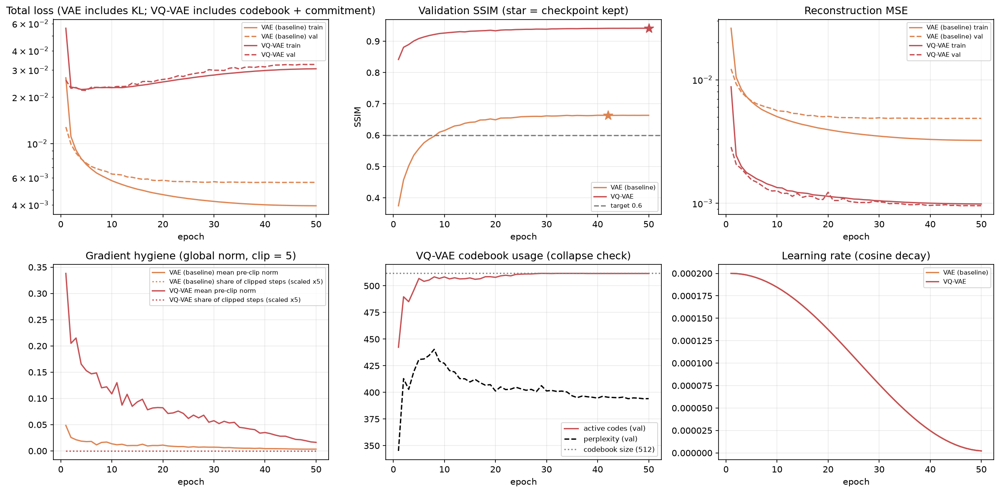

_Figure 3: Training losses, validation SSIM, reconstruction MSE, gradient norms, codebook use, and learning rate._

Training stability was assessed using finite-loss checks, epoch-to-epoch loss changes, gradient norms, gradient clipping frequency, validation performance, and VQ-VAE codebook utilisation. The autoregressive prior was evaluated separately using training and validation cross-entropy.

Both autoencoders completed 50 training epochs without non-finite losses or loss spikes exceeding a 50% increase between consecutive epochs. Neither required gradient clipping. Mean pre-clipping gradient norms were `0.01` for the VAE and `0.08` for the VQ-VAE. Validation SSIM fluctuations during the final ten epochs were also small, with standard deviations of successive changes of `0.0002` and `0.0001`, respectively.

The VQ-VAE's detailed training history shows that its reconstruction quality improved throughout training. Validation MSE decreased from 0.00286 to 0.000958, while validation SSIM increased from `0.842` to `0.941`. Gradient norms declined from `0.338` to `0.016`, without any clipping events. Although the total validation loss increased after reaching its minimum at epoch 5, this occurred alongside improving reconstruction metrics and increasing codebook and commitment losses, indicating a trade-off between objective components rather than numerical divergence.

Codebook utilisation also remained healthy. Active training entries increased from approximately `191` to all `512` entries, with final training and validation perplexities of approximately `390` and `394`, respectively. This provides no evidence of severe codebook collapse.

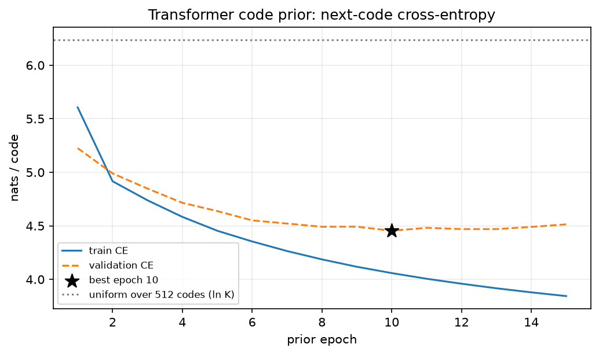

_Figure 4: Transformer-prior next-code cross-entropy._

Validation cross-entropy plateaued at approximately epoch 10, supporting early stopping rather than selecting the final training epoch. Uniform prediction over 512 code entries corresponds to approximately `6.24` nats per code; both training and validation losses fell below this reference, showing that the prior learned code dependencies.

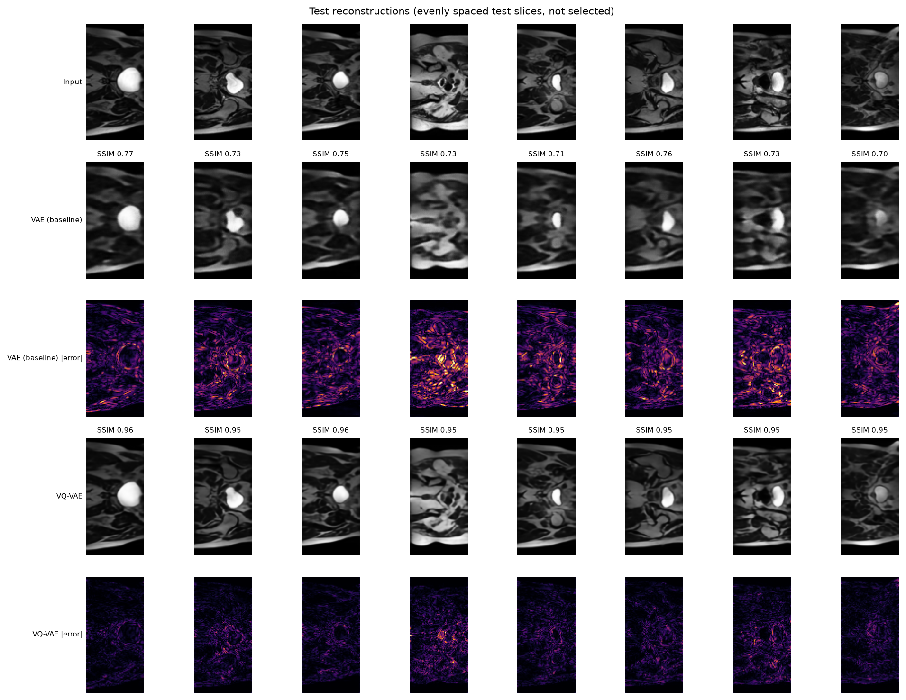

_Figure 5: VAE and VQ-VAE test reconstructions with error maps._

The VAE preserves large structures but blurs fine boundaries. VQ-VAE reconstructions retain more detail and have lower errors, consistent with their higher SSIM.

### Generated samples and quantitative comparison

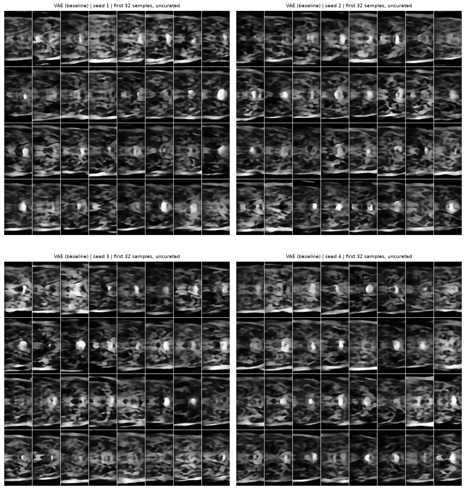

_Figure 6: Uncurated VAE samples._

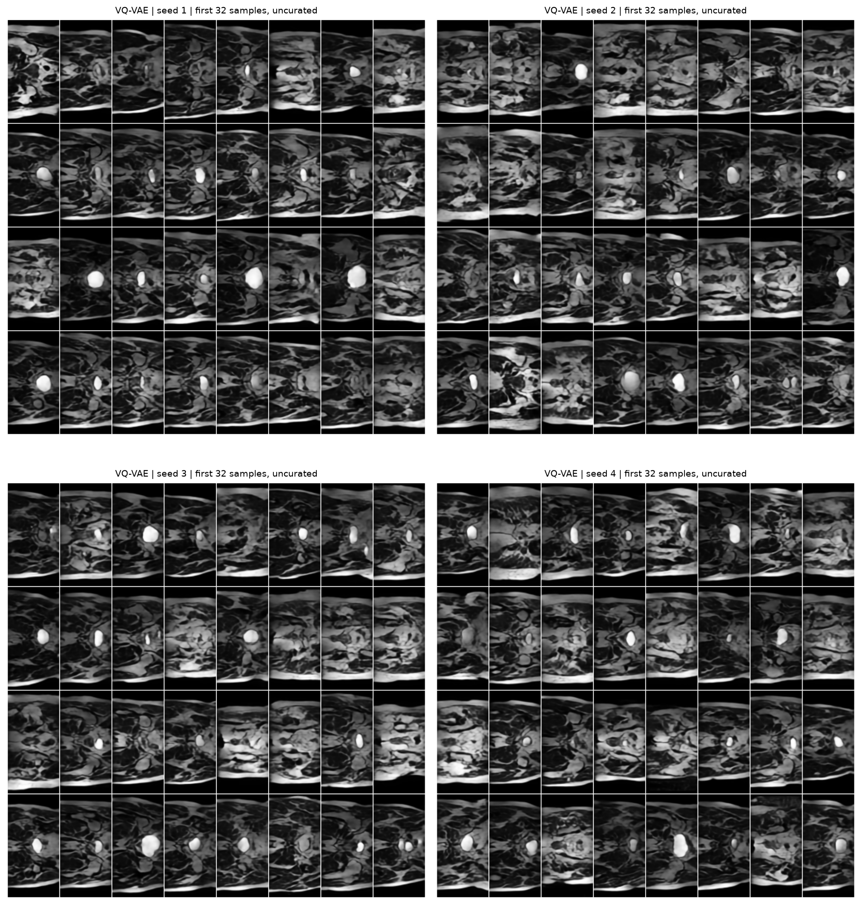

_Figure 7: Uncurated VQ-VAE samples._

The VAE produces recognisable MRI-like images but often blurs tissue boundaries. VQ-VAE samples generally retain sharper local patterns, although some samples contain irregularities and anatomically inconsistent structures. Uncurated grids and diagnostic samples from multiple random seeds were inspected to avoid relying on a single favourable sample.

| Metric | VAE baseline | VQ-VAE | Held-out real reference |
|---|---:|---:|---:|
| Test reconstruction SSIM | `0.713` | `0.950` | — |
| Best-match SSIM to training images | `0.293` | `0.341` | `0.343` |
| Fréchet distance (Inception-v3 features; lower is better) | `226.32` | `75.14` | `51.59` |

Both models exceed the `0.6` target on **paired test reconstructions**. The VQ-VAE also has a substantially lower Fréchet distance than the VAE, although its distance remains higher than the real-versus-real reference. Precision, recall, density, and coverage also favoured the VQ-VAE, particularly recall, but its precision, density, and coverage remained below the held-out real reference.

> **Metric distinction:** The `0.6` SSIM target is met by the paired reconstruction results. The best-match SSIM values in the second row are nearest-neighbour similarity measurements, not the same metric or a pass/fail test for generated-image fidelity.

### Distribution and codebook analysis

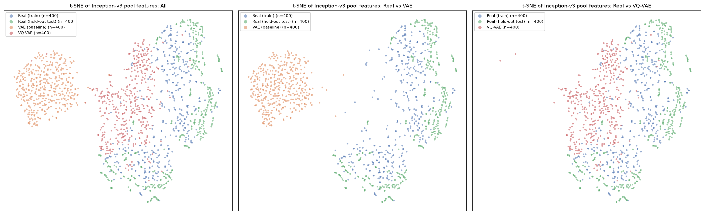

_Figure 8: t-SNE of Inception-v3 features for training, held-out real, VAE-generated, and VQ-VAE-generated images._

The VAE samples form a more separated feature cluster. VQ-VAE samples lie closer to the real-data groups, but some separation remains. t-SNE is qualitative: a two-dimensional projection can distort distances and does not prove that the distributions are equivalent.

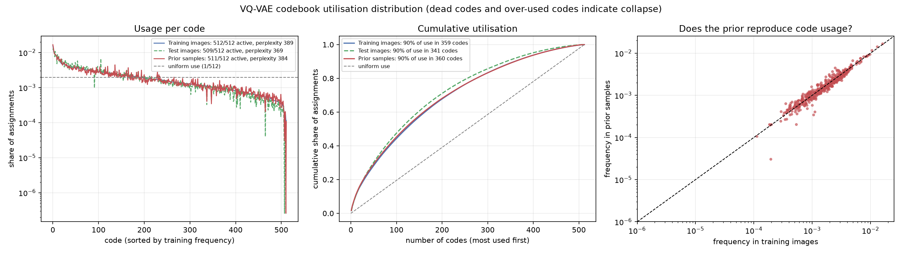

_Figure 9: Codebook assignment distribution._

| Codebook metric | Training images | Held-out test images | Prior-generated samples |
|---|---:|---:|---:|
| Active entries | `512/512` | `509/512` | `511/512` |
| Perplexity | `389` | `369` | `384` |
| Codes accounting for 90% of assignments | `359` | `341` | `360` |

Use is non-uniform, but activity across nearly all 512 entries and the reported perplexities provide no evidence of severe codebook collapse. The prior also broadly reproduces the marginal code-frequency distribution.

### Nearest-neighbour and memorisation audit

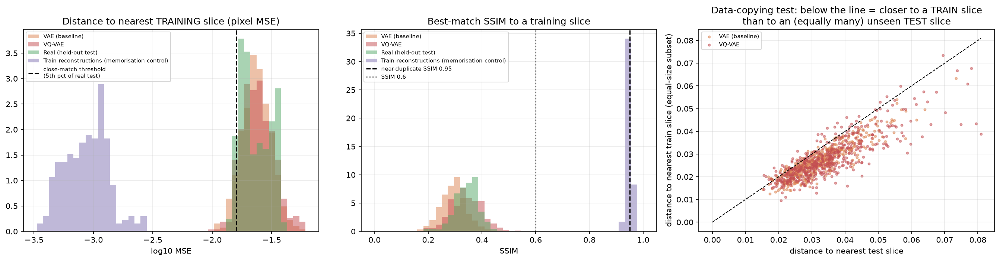

_Figure 10: Generated-sample distances and similarities compared with training and held-out real images._

VQ-VAE mean best-match SSIM to training images was `0.341`, close to the `0.343` for held-out real images. Furthermore, the train-versus-test distance plot shows a slight tendency for generated samples to be closer to a training neighbour, however, it does not show obvious systematic pixel-level copying. 

The nearest-neighbour analysis also found no obvious systematic pixel-level copying in the inspected generated samples. The mean best-match SSIM for VQ-VAE generations was comparable to that of held-out real images against the training set, providing a useful reference for naturally occurring anatomical similarity.

However, these measurements are screening evidence rather than a formal privacy assessment. Similarity-based comparisons cannot establish the absence of patient information, membership inference risk or patient re-identification. The results therefore support the conclusion that obvious training-image duplication was not observed, but do not establish that the generated dataset is anonymous or privacy-preserving.

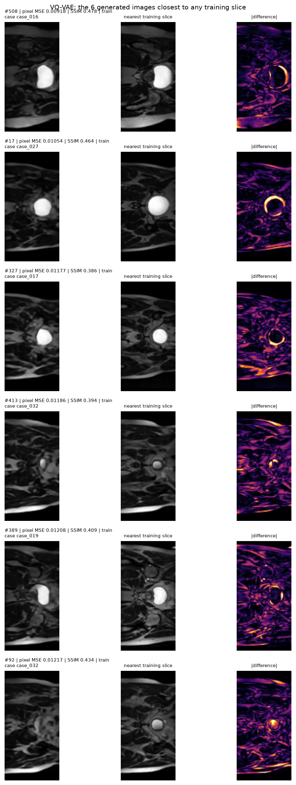

_Figure 11: VQ-VAE samples, nearest training slices, and difference maps._

The VQ-VAE's six closest training-slice matches exhibit measurable pixel-level and structural differences. Their anatomical similarities are consistent with learning shared MRI characteristics rather than simply reproducing individual training examples.

The closest matches had pixel MSE values between `0.00918` and `0.01217`, with SSIM values ranging from `0.386` to `0.478`. Visual inspection of the generated images, nearest training slices and absolute difference maps revealed no obvious exact or near-identical reproductions. Although the images share common anatomical structures, differences remain in tissue patterns, anatomical boundaries, structural positioning and intensities.

The results are encouraging, particularly because the audit examines the closest matches rather than randomly selected generations. Nevertheless, the relatively small number of inspected examples and the absence of a formal patient-level privacy assessment prevent a definitive conclusion that memorisation has been eliminated.

### Failure-case autopsy

The following five VQ-VAE samples were selected automatically using diagnostic criteria, not hand-picked examples. Each is compared with its nearest training slice in the failure figure . The metrics identify observable image defects; they are not clinical diagnoses.

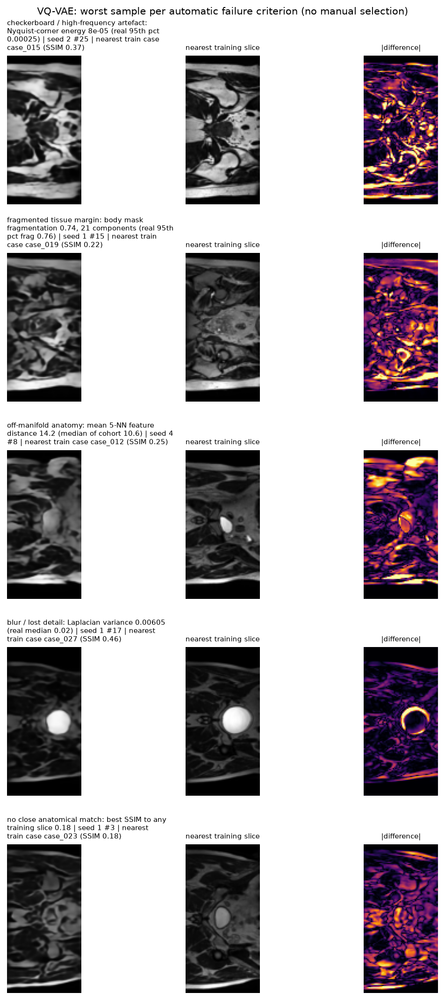

_Figure 12: Five automatically selected VQ-VAE generation failures, nearest training neighbours, and difference maps._

| Failure mode | Generated sample | Diagnostic evidence | Nearest training case | SSIM |
|---|---|---|---|---|
| High-frequency / checkerboard artefact | Seed 2, sample 25 | Nyquist-corner energy `0.00008`, above the real-data 95th percentile (`0.00025`) | `case_015` | `0.37` |
| Fragmented tissue margin | Seed 1, sample 15 | Body-mask fragmentation `0.74` across 21 components; real-data 95th-percentile fragmentation was `0.76` | `case_019` | `0.22` |
| Off-manifold anatomy | Seed 4, sample 8 | Mean 5-NN feature distance `14.2`, versus cohort median `10.6` | `case_012` | `0.25` |
| Blur / lost detail | Seed 1, sample 17 | Laplacian variance `0.00605`, below the real-data median (`0.02`) | `case_027` | `0.46` |
| No close anatomical match | Seed 1, sample 3 | Best SSIM to any training slice was `0.18` | `case_023` | `0.18` |

**Root-trigger analysis**

1. High-frequency / checkerboard artefact (Seed 2, sample 25)

The visible high-frequency artefacts may originate from interactions between discrete latent quantisation and decoder reconstruction. The encoder compresses the input into a 32 × 16 code grid, where abrupt changes between neighbouring codebook entries may introduce local discontinuities during decoding. Alternatively, the autoregressive prior may generate locally inconsistent combinations of otherwise valid codes. Although the decoder uses nearest-neighbour upsampling to reduce conventional transposed-convolution checkerboard artefacts, this does not prevent other periodic reconstruction patterns. The SSIM-weight experiments indicate that reconstruction sharpness is sensitive to the loss balance; however, the measured Nyquist-corner energy of `0.00008` is below the real-data 95th percentile of `0.00025`, so the spectral measurement does not independently confirm an unusually strong high-frequency component.

2. Fragmented tissue margin (Seed 1, sample 15)

The fragmented tissue boundaries may result from insufficient spatial detail in the quantised latent representation. Compressing the 128 × 64 input into a 32 × 16 grid can discard fine anatomical structures, while assigning encoder features to discrete codebook entries introduces additional representational approximation. The autoregressive prior may also contribute because its next-token objective learns code dependencies without explicitly enforcing anatomical connectivity. The downsampling experiments support the importance of preserving spatial resolution: increasing the number of downsampling stages from two to three substantially degraded reconstruction SSIM from `0.9245` to `0.7754`. However, the measured fragmentation score of `0.74` remains below the real-data 95th percentile of `0.76`, so the diagnostic alone does not establish unusually severe fragmentation.

3. Off-manifold anatomy (Seed 4, sample 8)

The unusual anatomical arrangement may indicate that the autoregressive prior has not fully learned the global dependencies between spatially related latent codes. Although its six transformer blocks model preceding tokens through causal attention, the next-token cross-entropy objective does not explicitly constrain the resulting images to follow anatomically plausible global structures. Consequently, locally plausible code selections may combine into atypical anatomical arrangements. The sample's mean five-nearest-neighbour feature distance of `14.2`, compared with the cohort median of `10.6`, supports its identification as a feature-space outlier. Prior validation cross-entropy also plateaued at approximately epoch 10, suggesting limited further improvement in modelling code dependencies. Healthy codebook utilisation, however, makes severe codebook collapse an unlikely explanation.

4. Blur / lost detail (Seed 1, sample 17)

The reduced image detail is consistent with information loss through the encoder's spatial compression and vector quantisation. Fine anatomical boundaries and intensity variations may not be retained in the 32 × 16 latent representation, leaving the decoder unable to reconstruct details that were discarded during encoding. The reconstruction objective may reinforce this effect because pixel-wise MSE does not specifically preserve high-frequency detail. Supporting this explanation, increasing the SSIM loss weight from `0` to `0.1` improved the sharpness ratio from approximately `0.604` to `0.763`, while increasing codebook size from `512` to `1024` also improved reconstruction sharpness. The sample's Laplacian variance of `0.00605`, substantially below the real-data median of `0.02`, provides quantitative evidence of reduced detail.

5. No close anatomical match (Seed 1, sample 3)

The low best-match SSIM of `0.18` may result from stochastic sampling of the autoregressive prior producing a latent-code sequence substantially different from those observed in individual training examples. Because predictions are conditioned on preceding tokens, differences in earlier code selections can influence the composition of the remaining sequence, introducing anatomical variations that may improve diversity but also produce atypical structures. However, low nearest-neighbour similarity is not necessarily a generation failure: it may indicate useful novelty rather than anatomical implausibility or memorisation avoidance alone. This sample should therefore be treated as a low-similarity outlier rather than a confirmed anatomical failure. Additional feature-space comparisons against held-out real images and anatomical plausibility inspection would be needed to distinguish useful diversity from an invalid generation.

**Overall interpretation**

The five cases suggest that generation quality is influenced by both the discrete autoencoder and the autoregressive prior. High-frequency artefacts and loss of detail are consistent with limitations in quantised spatial representation and decoder reconstruction, while fragmented boundaries may reflect inadequate preservation of spatial continuity. Off-manifold anatomy is more directly consistent with imperfect modelling of global code dependencies by the autoregressive prior. A generation with no close training neighbour, however, cannot be classified as defective on similarity alone.

The later hyperparameter experiments provide supporting architectural evidence. Increasing the SSIM loss weight improved reconstruction sharpness, increasing codebook size improved several reconstruction and distributional measures, and additional downsampling substantially degraded image quality. These results suggest that preserving latent spatial resolution and balancing reconstruction and structural objectives are important for generation quality. Nevertheless, the experiments do not isolate the causes of individual failure cases. Controlled comparisons between reconstructed and prior-generated samples are required to distinguish decoder and quantisation limitations from errors introduced by autoregressive sampling.

### Distinguishing Reconstruction and Generative Fidelity

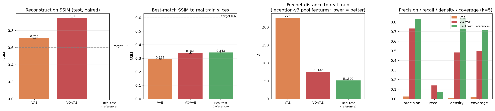

_Figure 13 - Metric Comparision_

The SSIM acceptance threshold of `0.6` is evaluated using paired held-out test reconstructions. Both the VAE and VQ-VAE exceed this threshold, demonstrating that their respective decoders preserve substantial structural information from their input slices.

This result should not be interpreted as demonstrating equivalent similarity for prior-generated synthetic images. Generated-image fidelity and diversity are evaluated separately using feature-space Fréchet distance, precision, recall, coverage and nearest-neighbour similarity. These metrics compare properties of generated and real cohorts rather than the reconstruction accuracy of individual input images.

The VQ-VAE achieves a lower Inception-v3 feature-space Fréchet distance than the VAE, indicating a closer generated distribution under the selected evaluator. Nevertheless, the remaining difference from the held-out real-data reference demonstrates that the generated distribution is not equivalent to the real distribution.

### Latent-space interpolation

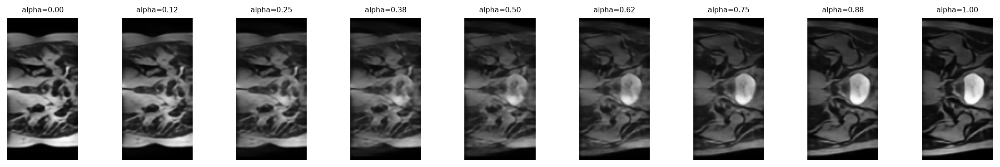

_Figure 14: VQ-VAE - Latent-space interpolation between a training image and a synthetic image_

To investigate the structure of the learned latent representation, linear interpolation was performed between two encoded HipMRI slices. Intermediate latent representations were generated at nine interpolation coefficients, ranging from `α = 0.00` to `α = 1.00`, and decoded using the VQ-VAE decoder.

For linear interpolation, the intermediate representation is calculated as:

`z_alpha = (1 - alpha) * z_start + alpha * z_end`

The resulting sequence demonstrates a gradual transition between the endpoint images. The prominent high-intensity anatomical structure remains recognisable throughout the interpolation, while surrounding tissue patterns, boundaries and intensity distributions change progressively. No obvious abrupt structural discontinuities are apparent at the sampled interpolation points.

These results provide qualitative evidence that the learned latent representation captures variations between the selected anatomical images rather than restricting reconstruction to the original endpoints. However, smooth visual transitions do not independently establish anatomical validity, and the experiment examines only one interpolation path rather than the structure of the entire latent space. 

### Computational profile

Computational profiling was performed on an Apple M5 Pro (64 GiB unified memory) using PyTorch 2.14.1 and the MPS backend, with float32 inputs of size 128 × 64. Measurements use warmed-up runs and report median latency; generation was measured over five runs. The models were randomly initialised, so these results characterise architectural resource requirements rather than the performance of trained checkpoints.

| Metric | VAE | VQ-VAE |
|---|---:|---:|
| Autoencoder parameters | 3.55M | 2.00M |
| Prior parameters | — | 5.01M |
| Total parameters | 3.55M | 7.02M |
| Resident weights | 13.6 MiB | 27.0 MiB |
| Peak reconstruction memory (batch 64) | 40.7 MiB | 226.1 MiB |
| Peak training-step memory (batch 64) | 229.1 MiB | 2,285.5 MiB |
| Training-step latency (batch 64) | 23.8 ms | 172.7 ms |
| Autoencoder training time | 19.25 min | 85.53 min |	
| Total training time (including prior) | 19.25 min | 174.86 min |	
| Test reconstruction latency | 0.809 ms/sample | 0.955 ms/sample |
| Generation latency | 1.687 ms/sample | 137.439 ms/sample |
| Generation runtime (64 samples) | 0.108 s | 8.796 s |	

The results show that while the VQ-VAE has a smaller autoencoder (43.7% fewer parameters), its additional prior network increases the total parameter count by 97.7% compared with the standard VAE. This also results in substantially higher memory requirements, with peak reconstruction and training memory increasing by 5.56× and 9.98×, respectively. The VQ-VAE also has a considerably higher training-step latency (7.26× slower), although test reconstruction latency is relatively similar, with only an 18% increase. The most significant difference is generation speed: the VQ-VAE is approximately 81.5× slower due to the additional computational cost of its prior-based generation process. Overall, the VAE offers substantially better computational and memory efficiency, while the VQ-VAE introduces significant overhead, particularly during training and generation.

The higher VQ-VAE training latency and memory requirements make it more sensitive to batch size and available unified memory. Its autoregressive generation also limits practical sampling throughput. These costs should be considered when selecting batch sizes, planning experiments, and generating synthetic datasets. MPS memory measurements are approximate, include allocator caching where reported by the driver, and may vary with system memory pressure and thermal conditions.

## 7. Hyperparameter Experiments and Further Actions

### Experimental protocol

Three one-factor-at-a-time hyperparameter sweeps were conducted using `experiments.py`. Each configuration was trained for 30 epochs across three random seeds (42, 43, 44), with results reported as mean ± standard deviation. Unless otherwise specified, the VQ-VAE configuration used the default codebook size of `512`, an SSIM loss weight of `0`, and two downsampling stages. The SSIM loss weight of `0` was used rather than the current model's `0.1` for a closer comparison with the baseline model.

Reconstruction quality was assessed using test SSIM and mean squared error (MSE). Generated-sample quality was assessed using best-match SSIM, pixel-PCA Fréchet distance (FD), precision, recall, coverage, close-match rate, and sharpness ratio. Codebook utilization and prior validation cross-entropy (CE) were recorded where applicable.

### 1. Codebook size

| Codebook size | Test SSIM ↑ | Test MSE ↓ | FD ↓ | Precision ↑ | Recall ↑ | Best-match SSIM ↑ | Close-match rate ↓ | Sharpness ratio | Perplexity |
|---:|---:|---:|---:|---:|---:|---:|---:|---:|---:|
| 64 | 0.8882 ± 0.0013 | 0.001485 ± 0.000017 | 1.098 ± 0.340 | 0.9674 ± 0.012 | 0.8711 ± 0.043 | 0.3465 ± 0.015 | 0.1484 ± 0.032 | 0.528 ± 0.032 | 51.63 ± 0.99 |
| 128 | 0.9013 ± 0.0031 | 0.001302 ± 0.000031 | 1.011 ± 0.170 | 0.9648 ± 0.035 | **0.9023 ± 0.014** | **0.3599 ± 0.010** | **0.1341 ± 0.037** | 0.5735 ± 0.038 | 101.3 ± 3.3 |
| 256 | 0.9140 ± 0.0013 | 0.001144 ± 0.000020 | 1.062 ± 0.220 | 0.9714 ± 0.036 | 0.8620 ± 0.066 | 0.3551 ± 0.013 | 0.1419 ± 0.063 | 0.5733 ± 0.023 | 192.4 ± 0.73 |
| **512 (defailt)** | 0.9245 ± 0.0034 | 0.001016 ± 0.000043 | 0.8993 ± 0.060 | 0.9701 ± 0.025 | 0.8789 ± 0.031 | 0.3540 ± 0.0072 | 0.2096 ± 0.044 | 0.6035 ± 0.063 | 360.1 ± 5.5 |
| 1024 | **0.9323 ± 0.0033** | **0.0009107 ± 0.000039** | **0.8777 ± 0.013** | **0.9753 ± 0.0081** | 0.8581 ± 0.046 | 0.3519 ± 0.0014 | 0.1445 ± 0.028 | **0.655 ± 0.030** | 721.2 ± 6.2 |

*Arrows indicate the preferred direction. Values are mean ± standard deviation across three seeds.*

Increasing the codebook size improved reconstruction quality monotonically. Increasing it from `512` to `1024` raised test SSIM from `0.9245` to `0.9323` and reduced MSE from 0.001016 to 0.0009107. FD also decreased from `0.8993` to `0.8777`, while precision and sharpness ratio increased.

However, these gains did not extend to every criterion. Recall and best-match SSIM were highest at `128`, and the close-match rate at `512` was substantially higher than at the other tested sizes. The `1024` entry codebook therefore offers a promising reconstruction and sample-quality trade-off, but its larger latent vocabulary does not by itself establish better privacy or anatomical validity. The differences in FD and close-match rate should also be interpreted in light of variation across seeds.

### 2. SSIM loss weight

| Model | SSIM weight | Test SSIM ↑ | Test MSE ↓ | FD ↓ | Precision ↑ | Recall ↑ | Best-match SSIM ↑ | Close-match rate ↓ | Sharpness ratio |
|---|---:|---:|---:|---:|---:|---:|---:|---:|---:|
| VAE | 0 | 0.6970 ± 0.0008 | **0.004430 ± 0.000033** | **0.5176 ± 0.046** | 0.7214 ± 0.013 | 0.8477 ± 0.027 | 0.2895 ± 0.0028 | 0.0599 ± 0.016 | 0.2864 ± 0.0073 |
| VAE | 0.05 | 0.7403 ± 0.0006 | 0.004643 ± 0.000014 | 0.5267 ± 0.052 | 0.6680 ± 0.020 | 0.8698 ± 0.009 | 0.2846 ± 0.0020 | **0.0326 ± 0.011** | 0.3524 ± 0.0060 |
| VAE | 0.1 | 0.7444 ± 0.0008 | 0.004847 ± 0.000012 | 0.5474 ± 0.070 | 0.6641 ± 0.0068 | 0.8750 ± 0.0068 | 0.2832 ± 0.0011 | 0.0391 ± 0.010 | 0.3727 ± 0.0090 |
| VAE | 0.25 | 0.7463 ± 0.0007 | 0.005097 ± 0.000026 | 0.5647 ± 0.071 | 0.6510 ± 0.032 | 0.8607 ± 0.015 | 0.2829 ± 0.0030 | 0.0404 ± 0.023 | **0.3895 ± 0.0032** |
| VAE | 0.5 | 0.7462 ± 0.0008 | 0.005285 ± 0.000028 | 0.5991 ± 0.089 | 0.6458 ± 0.034 | **0.8828 ± 0.0068** | 0.2832 ± 0.0035 | 0.0391 ± 0.014 | 0.3852 ± 0.013 |
| VQ-VAE | **0 (default)** | 0.9245 ± 0.0034 | 0.001016 ± 0.000043 | **0.8993 ± 0.060** | 0.9701 ± 0.025 | 0.8789 ± 0.031 | 0.3540 ± 0.0072 | 0.2083 ± 0.043 | 0.6035 ± 0.063 |
| VQ-VAE | **0.05** | 0.9438 ± 0.0013 | **0.0009531 ± 0.000022** | 0.9916 ± 0.240 | 0.9479 ± 0.018 | 0.8867 ± 0.017 | 0.3528 ± 0.0063 | **0.0898 ± 0.047** | 0.7522 ± 0.043 |
| VQ-VAE | **0.1 (current)** | 0.9458 ± 0.0010 | 0.0009610 ± 0.000020 | 1.082 ± 0.390 | 0.9518 ± 0.0045 | 0.8945 ± 0.050 | **0.3583 ± 0.0054** | 0.0977 ± 0.038 | **0.7633 ± 0.034** |
| VQ-VAE | 0.25 | 0.9477 ± 0.0005 | 0.0009792 ± 0.000011 | 0.8924 ± 0.210 | **0.9635 ± 0.018** | **0.8984 ± 0.048** | 0.3510 ± 0.017 | 0.1263 ± 0.033 | 0.7490 ± 0.040 |
| VQ-VAE | 0.5 | **0.9481 ± 0.0005** | 0.001010 ± 0.000010 | 1.044 ± 0.260 | 0.9753 ± 0.011 | 0.8828 ± 0.027 | 0.3395 ± 0.018 | 0.1055 ± 0.014 | 0.7180 ± 0.033 |

*Values are mean ± standard deviation. Bold identifies selected reference values or the best observed value for a particular metric within each model; it does not imply statistical significance.*

For the VAE baseline, increasing the SSIM weight improved test SSIM but increased MSE and FD. A weight of `0.05` produced the lowest close-match rate, while larger weights generally increased the sharpness ratio. This illustrates that better reconstruction structure does not necessarily imply better generated-sample distribution quality.

For the VQ-VAE, a weight of `0.05` is a promising alternative to the current weight of `0.1`. It achieved a test SSIM of 0.9438, a slightly lower MSE of `0.0009531`, and a lower close-match rate of `0.0898`, compared with `0.9458`, `0.0009610`, and `0.0977` at `0.1`. Its recall was also slightly lower, while FD was lower than at `0.1` but remained variable across seeds.

A weight of `0.25` produced the highest mean recall in this sweep, whereas `0.5` produced the highest mean test SSIM and precision. Neither was uniformly better: best-match SSIM declined as the weight increased beyond `0.1`, and the close-match rate increased at `0.25` and `0.5`. The modest reconstruction gains at higher weights therefore do not justify selecting them on SSIM alone.

### 3. Number of downsampling stages

| Downsampling stages | Parameters | Test SSIM ↑ | Test MSE ↓ | FD ↓ | Precision ↑ | Recall ↑ | Best-match SSIM ↑ | Close-match rate ↓ | Sharpness ratio | Training time (s) |
|---:|---:|---:|---:|---:|---:|---:|---:|---:|---:|---:|
| **2 (default)** | 2.003M | **0.9245 ± 0.0034** | **0.001016 ± 0.000043** | **0.8993 ± 0.060** | **0.9701 ± 0.025** | **0.8789 ± 0.031** | **0.3540 ± 0.0072** | 0.2083 ± 0.043 | **0.6035 ± 0.063** | 4773 ± 340 |
| 3 | 7.924M | 0.7754 ± 0.0076 | 0.003348 ± 0.000100 | 1.067 ± 0.150 | 0.9570 ± 0.017 | 0.8346 ± 0.012 | 0.3538 ± 0.0055 | **0.1549 ± 0.047** | 0.4142 ± 0.027 | 5199 ± 290 |

Two downsampling stages substantially outperformed three in reconstruction quality, FD, precision, recall, and sharpness ratio, while requiring fewer parameters and less training time in this sweep. Three stages reduced the close-match rate, but the result was accompanied by substantially worse reconstruction and distribution metrics. The similar best-match SSIM values do not offset these differences.

The two-stage architecture should therefore remain the default. A deeper encoder-decoder is not justified by these results, although the lower close-match rate at three stages warrants further investigation rather than being interpreted as conclusive evidence of improved privacy.

### Interpretation and limitations

The sweeps reveal trade-offs between reconstruction fidelity, sample diversity, distributional similarity, and potential memorisation. Although all configurations exceeded the reconstruction SSIM threshold, none provided uniformly improved results that would justify an imediate change to the model configuration.

The held-out real-data reference values were FD = `3.7`, precision = `0.875`, recall = `0.0703`, coverage = `0.492`, density = `0.777`, best-match SSIM = `0.335`, and pairwise SSIM = `0.164`. The generated-sample FD values were lower than the real-data reference under the same evaluation procedure, but this should not be interpreted as proof that synthetic samples are more realistic. These metrics use pixel-PCA features and small cohorts, so their absolute values are not equivalent to published FID results. In particular, the very different precision and recall values indicate that the generated and real sample distributions behave differently under the evaluator.

Close-match rate is a useful screening measure, not a privacy guarantee. Best-match SSIM also measures similarity rather than clinical correctness: a high value can indicate faithful anatomical structure, but it can also indicate excessive similarity to a training example. Conversely, a low value does not establish anatomical plausibility or safety. None of the reported metrics establishes concrete diagnostic utility, preservation of pathology, or absence of patient information.

Differences should be interpreted in relation to the reported seed variability. Three repeats provide an initial estimate of stability, not a definitive statistical comparison. Generation metrics and the selected checkpoint should be re-evaluated on a larger sample before drawing conclusions about memorisation, diversity, or clinical suitability.

### Actionable Recommendations

The current configuration (`codebook_size=512`, `ssim_weight=0.1`, and two downsampling stages) provides a useful reference for controlled follow-up experiments. The sweeps suggest the following changes for further investigation:

1. **Increase the codebook size to 1024.** This setting improved mean test SSIM, MSE, FD, precision, and sharpness ratio in the codebook sweep. The trade-off is reduced recall relative to 128 and no clear improvement in best-match SSIM. Evaluate whether the larger codebook improves anatomical detail without increasing training-image similarity or reducing sample diversity.

2. **Reduce the SSIM weight to 0.05.** Relative to `0.1`, this setting slightly improved MSE and reduced the mean close-match rate from `0.0977` to `0.0898`, with a small decrease in test SSIM. It is a promising candidate for reducing excessive similarity, but the close-match result has substantial seed variability and does not demonstrate privacy.

3. **Retain two downsampling stages.** Three stages increased parameter count from approximately `2.0M` to `7.9M` and degraded reconstruction and several generation metrics. Further architecture changes should focus on preserving spatial detail and avoiding artefacts rather than simply increasing depth.

4. **Evaluate the combined configuration.** The next experiment should combine `codebook_size=1024`, `ssim_weight=0.05`, and `downsample_stages=2`. This configuration combines promising results from the individual sweeps, but the joint effect is unknown because the hyper-parameters were varied separately. Train it with the same data split, epoch budget, and seeds as the reference model. Compare the combined model against the current configuration and the best individual alternatives before accepting the change.

5. **Prioritise anatomical plausibility and downstream safety.** Inspect uncurated sample grids, latent-space interpolations, and automatically flagged failures. Review tissue boundaries, spatial continuity, implausible structures, and artefacts with appropriate domain expertise. Where segmentation labels are available, assess anatomical consistency against them. Before using synthetic images for downstream training, compare downstream performance using real-only, synthetic-only, and mixed training data, and evaluate performance on held-out real patients, including relevant subgroup and pathology-specific analyses where the dataset supports them.

6. **Validate reproducibility and distributional metrics.** Increase the number of repeats and generated samples, report uncertainty, and retain the best checkpoint selected using validation data. Keep the test set reserved for final evaluation. Reassess FD, precision, recall, coverage, sharpness, close-match rate, and prior validation CE together rather than optimising a single metric.

These experiments would test whether the modest improvements observed in individual sweeps transfer to a combined model and whether they improve the properties that matter for safe synthetic medical imaging. A configuration should only be recommended for downstream training after demonstrating adequate anatomical plausibility, useful sample diversity, acceptable similarity to training data, and performance on held-out real data. The present results motivate these investigations but do not establish that any configuration is clinically safe or privacy-preserving.


## 8. Discussion and Conclusion

The VQ-VAE is the stronger model on this dataset: it improves reconstruction SSIM from `0.713` to `0.950`, reduces Fréchet distance from approximately `226` to `75.14`, and uses almost the entire codebook. Its feature distribution is closer to real HipMRI than the VAE's, but it remains different from the held-out real reference and still produces occasional artefacts.

The gain has a substantial cost: the VQ-VAE has nearly twice as many trainable parameters, takes about nine times longer to train, and has about `81.5` times the generation latency. This may be acceptable for small research cohorts, but is inefficient for high-throughput generation without prior optimisation.

The findings have important limits:

- **Generalisation:** only 38 patients were available, with three in the held-out test partition. Independent patients and imaging centers are needed for stronger generalisation evidence.
- **Anatomical validity:** no expert clinical review was performed. MSE, SSIM, Inception features, frequency measures, and t-SNE cannot establish physiological correctness.
- **Privacy:** no differential-privacy mechanism, membership-inference test, or patient re-identification evaluation was performed. Nearest-neighbour differences do not prove anonymity or safe sharing.
- **Volumetric consistency:** the model generates independent 2D slices and does not enforce continuity between adjacent slices.
- **Downstream utility:** the project did not test whether synthetic images improve a model trained for a medical-imaging task. A future study should compare downstream performance on held-out real patients with and without synthetic augmentation.

### Conclusion

Retain the VQ-VAE as the preferred experimental architecture for further research, but treat its outputs as research prototypes only. Do not regard them as clinically validated or privacy-guaranteed data. Before downstream use or sharing, obtain expert anatomical review, test patient-level generalisation and privacy risk, and evaluate utility on a separate task using held-out real patients. Optimising the autoregressive prior should be a priority if generation throughput matters.

## 9. Artificial Intelligence Usage Disclosure

I personally take 100% responsibility for every line of code, loss formula, and metric in this submission. While AI was used in the submission, the final decisions were left to myself to approve/disapprove and therefore so does the responsibility for the work.

### Tools used

Claude (Anthropic) was used throughout this project to assist in the generation of code for the models, figures and results mentioned throughout this report based on human decisions as described. ChatGPT was used in explain concepts and results where no code needed to be generated.

### Tasks supported by AI

1. Initial scaffolding and implementation of `modules.py` and `dataset.py`, and the `train.py` training loop base on decisions made in the initial feasibility specification.
2. Iterations on the initial model designs including converting the baseline model from an AE to VAE.
3. The production of tools such as `explore.py`, `evaluate.py` and its helpers to assist in diagnosing problems and benchmarking solutions such that future decisions and analysis can be confidently made.
4. Constructing `predict.py` as well as drafting much of the initial feasibility report
5. Drafting this README report based on visual and quantitative data produced by the model.
6. Explaining core concepts throughout the entire process to provide an overview of the specific concept, such as Autoencoders, codebook collapse or SSIM, for consolation rather than reading in depth scientific papers.

### Review and verification

All code was manually reviewed ensuring that there were no obvious bugs or inaccuracies while ensuring strict version control so, that if any issues were later found to be introduced by the foreign code, changes can be rolled back to the last stable version. The models were then verified based on visual sample reconstruction and generations to ensure that the outputted samples match what is suggested by the numerical results. Finally, solutions to issues proposed to the AI model where tested to determining whether the cause of the issue was identified or whether the changes made did not address the original issue. The original figures were referenced to ensure that all results matched the model output rather than being hallucinated by the LLM.

## 10. References

1. The University of Queensland. (2026). *COMP3710/COMP7710 Pattern Recognition: Version 2.5 Final Assessment Specification*.
2. van den Oord, A., Vinyals, O., & Kavukcuoglu, K. (2017). Neural discrete representation learning. *Advances in Neural Information Processing Systems*, 30.
3. Wang, Z., Bovik, A. C., Sheikh, H. R., & Simoncelli, E. P. (2004). Image quality assessment: From error visibility to structural similarity. *IEEE Transactions on Image Processing*.
4. PyTorch Team. (2026). *PyTorch Documentation* (Version 2.14). https://docs.pytorch.org/docs/2.14/index.html
